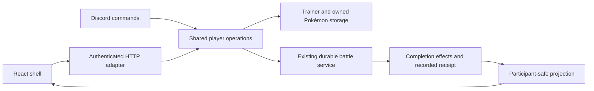

# Web release foundation and first playable slice

## Goal Capsule

**Objective:** A trainer can inspect their Pokémon, prepare a party, start an
NPC battle, continue across Discord/web and inspect their saved progression.

**Means:** Extend the existing React shell and shared server services in six
bounded PRs, using the selected Jewel presentation and existing battle client.

**Authority:** Latest maintainer decisions → current release ticket acceptance →
[UI guide](../web-ui-style-guide.md) and shared battle contracts → this plan.
Follow the [release branch workflow](../efforts/web-parity.md#release-branch-workflow--2026-10-29).
Each PR targets `codex/web-release`; merge after approval. The maintainer owns
release-to-main. This plan is not production-deployment authority.

**Execution boundary:** Begin with U1. Later units depend on their listed
prerequisites and the server-owned interaction-grant boundary below. Do not expand
this into the entire release backlog or call #235 complete from mocked tests.

---

## Product Contract

### Summary and problem frame

The web client currently resumes durable battles but has no collection/party
journey or browser NPC start. The studies establish visual direction, not those
operations. Deliver one real journey before broadening to the remaining release
screens. Design each screen against real data shortly before its implementation.

### Key decisions

- **Jewel working presentation** (session-settled: user-directed — chosen over
  lighter and more experimental variants after visual comparison). Governs R1.
- **Rewards fourth, Bag in header** (session-settled: user-approved — chosen over
  Bag as a main tab to group reward-oriented destinations). Governs R2.
- **Constant interaction grants** (session-settled: user-directed — chosen over
  per-operation reward mapping for the initial implementation). Governs R6.

### Requirements

- **R1.** Extend the selected Jewel presentation and existing copy voice. Preserve
  battlefield layout, animation timing, targeting and participant projection.
- **R2.** Main tabs are Play, Pokémon, Catch, Rewards, More; default Play, no Home.
  Bag is near resources; Settings is a cog. Desktop sidebar/phone bottom bar,
  browser Back and direct battle links work consistently.
- **R3.** Authenticated acting users initialize with shared defaults once; existing
  trainers keep their profile/progress. Collection/detail enforce ownership.
- **R4.** Party/preset changes preserve 3×4 layout, six-Pokémon limit and swap
  semantics. Reject stale updates and prevent duplicate swaps across surfaces.
- **R5.** NPC start validates current eligibility and freezes the battle build.
  Response loss and replay recover the original battle, not a second start.
- **R6.** Successful web interactions receive a single constant EXP/money grant.
  Use 5 EXP / 10 money per successful authenticated user-triggered gameplay API
  request, including explicit reads. Exclude local navigation, auth/bootstrap,
  automatic polling and refresh. The server owns amounts and replay identity;
  retries and internal calls cannot multiply the grant.
- **R7.** Saved participant receipts distinguish confirmed applied effects,
  pending, failure and uncertain outcomes. Viewing/reloading does not issue an
  independent battle reward grant.
- **R8.** Empty/new-account, loading, unavailable, stale and uncertain states offer
  truthful next actions. Initialization is independent of tutorial completion.

### Scope boundaries

This slice covers #237 implementation support, #216, #197, #199, #210, #236 and
their bounded #235 proof. It does not finish every acceptance item merely by
landing a supporting PR. New accounts may be initialized before Catch is delivered;
show an explicit currently supported Discord route, never a fake web acquisition.
The full new-player web journey still requires Catch #203 and tutorial #217.

Deferred release work: Catch, Bag #201, Rewards feature claims (#196/#215/#217),
Shop, Crafting, training/builds and additional modes remain in their owning tickets.
Use truthful unavailable states in the integration shell until they land. Do not
ship fixture balances or pretend those destinations are implemented.

Non-goals: a new routing framework, global state rewrite, browser battle engine,
localization system, generic economy framework or Discord visual redesign. These
are unnecessary for the bounded journey. Revisit shared UI abstractions only as
implemented screens demonstrate repetition.

---

## Planning Contract

### Key technical decisions

- **KTD1. Extend the current shell and URL conventions.** Keep existing auth/audio
  providers and `?battle=<id>` links. Add a small route parser/state owner supporting
  tab navigation, popstate/hash changes and legacy battle URLs. The current
  `BattleFeature.tsx` reads battleId once at module load; move that input to a
  reactive boundary before supporting in-app route changes.
- **KTD2. Shared operations own writes.** Both Discord and HTTP adapters call the
  same bounded party/start operations. See [operation discovery](../web-player-operations.md)
  for source evidence and proposed identity/replay semantics. Do not wrap Discord
  render functions as web endpoints or add reward effects in React.
- **KTD3. Conditional writes and durable intent where needed.** Party writes use
  a shared version; swaps and starts retain actor/payload-bound intent and results.
  Whole-trainer refresh/update paths affecting those fields must be narrowed or
  join the same version boundary. Existing turn deduplication is not start proof.
- **KTD4. Receipts originate at effect application.** Extend completion projection
  from recorded participant effect outcomes. Preserve the completion boundary and
  #186's unresolved partial-write recovery; no claim of atomic multi-document
  awards without evidence.
- **KTD5. Extract a small visual foundation.** Start with semantic color/type/edge
  tokens, shell navigation, panel and action controls. Keep battle-specific CSS
  isolated. Treat prototype-only fixture actions and CSS overrides as references,
  not production architecture.

### Flow and ownership

For a write: validate actor/input → resolve existing request → check current
state/version → apply and record outcome → return projection. Lost responses
recover by original request identity. Invalid input and conflicts are rejected;
an interrupted operation remains unknown/pending until its durable state resolves.
Storage atomicity must be demonstrated per operation, not assumed from this flow.

### Open decisions and confidence limits

**R6 boundary settled:** the maintainer delegated the choice to the simplest
server-side implementation. Use one policy for user-triggered gameplay requests,
with the existing Discord 5/10 amounts. Implement durable grant identity and an
atomic resource increment before U3 wires rewarded reads; this must not wait for
U4's party operations. Browser intent is not authorization: authenticate and
validate on the server, and keep automatic requests outside the grant path.

**Before U4/U5 publication:** characterize legacy full-trainer writers and choose
the narrow persistence transaction/conditional-write shape that protects the
actual read/write set. This is implementation engineering, not a new product
choice. Prove crash/replay behavior before publishing mutating endpoints.

**Deferred to #217:** tutorial ledger mapping and Darkrai completion equivalence.
Do not infer completion from page visits or initialize through tutorial claims.

Research is local source inspection plus live issue acceptance, not provider or
DB verification. No new external library/provider choice is proposed. The plan
preserves existing OAuth and battle contracts rather than re-specifying them.

---

## Implementation Units

Each unit is one reviewable PR. The following PR waits for its predecessor to
merge into the release branch before starting; no production deployment is needed
between units. A deployed client requires its supporting API version first.

### U1. Jewel shell around existing battles

**Goal:** Make the accepted navigation real while preserving current battle use.
**Requirements:** R1, R2, R8. **Dependencies:** none.

**Files:** `web/src/App.tsx`, `web/src/style.css`,
`web/src/battles/BattleFeature.tsx`, `web/src/settings/AudioSettings.tsx`;
new `web/src/navigation/routes.ts`, `web/src/navigation/SiteShell.tsx`,
`web/src/navigation/routes.test.ts`, `web/src/navigation/SiteShell.test.ts`.

**Approach:** Apply KTD1/KTD5. Play initially uses the real active-battle list;
unfinished destinations have explicit availability copy. Keep browser audio
settings under the cog and defer shared trainer settings to #219. Do not replace
real results with prototype cards. Design the shared shell using Jewel, then
check a real battle and its named development story inside it.

**Test scenarios:**
1. Opening an existing battle URL preserves the selected battle through auth,
   navigation away/back and reload, including a non-root Pages base path.
2. Keyboard navigation, Back and phone bottom navigation select the same route;
   no Home or Summon label reappears. Cog and Bag have accessible names.
3. Unknown routes recover to Play; unfinished screens make no gameplay request.
4. Settings preserve current audio behavior; reduced motion and focus remain
   usable alongside production battle controls.

**Verification:** Client tests/build plus desktop/390px/320px browser checks,
long labels, fallback fonts, background contrast and no horizontal overflow.

### U2. Trusted trainer initialization

**Goal:** Signed-in users have one shared trainer and a usable profile/resource view.
**Requirements:** R3, R8. **Dependencies:** U1 merged.

**Files:** `src/web/battleApi.js`, `src/web/sessionStore.js`,
`src/services/trainer.js`, `src/config/trainerConfig.js`,
`src/web/__tests__/battleApi.test.js`; new
`src/services/__tests__/trainerInitialization.test.js`; `web/src/http.ts`,
`web/src/auth/useAuth.ts` and their adjacent test suites.

**Approach:** Initialize using the trusted OAuth profile, recover duplicate-key
creation races and preserve existing profile fields for id-only callers. Existing
valid sessions must also initialize a missing trainer from their trusted session
ID; optional profile fields get a neutral display fallback, then refresh on a
later trusted OAuth login. Do not require another login or accept browser-supplied
profile data to initialize the acting user. Return
only display/resource fields needed by the shell. Narrow refresh writes where
necessary. Use configured defaults, never prototype starter values.

**Test scenarios:**
1. Concurrent Discord/web first use produces one trainer and one starter grant.
2. Repeated login and id-only authenticated calls preserve profile and progress.
   An existing valid session with no trainer initializes without a new OAuth flow;
   missing profile fields neither erase stored data nor break the shell.
3. Arbitrary target IDs cannot initialize or read another trainer.
4. Failed initialization gives a recoverable state without claiming successful
   account setup; a retry recovers an already-created trainer.

**Verification:** Focused service/API tests, real Mongo uniqueness race and
OAuth sign-in evidence; record any unavailable environment explicitly.

### U3. Owned collection and detail

**Goal:** Inspect actual owned Pokémon and reach party preparation.
**Requirements:** R1–R3, R6, R8. **Dependencies:** U2 merged. Implement and verify
the durable grant boundary within this unit before wiring rewarded reads.

**Files:** `src/services/pokemon.js`, new `src/web/playerApi.js`,
`src/web/__tests__/playerApi.test.js`, `web/src/pokemon/CollectionPage.tsx`,
`web/src/pokemon/PokemonDetail.tsx`, `web/src/pokemon/collection.test.ts`;
existing HTTP composition in `src/web/battleApi.js`; new
`src/services/interactionRewards.js` and its focused service tests.

**Approach:** Design collection/detail with real DTOs, approved filters/sorts and
server-enforced ownership. Project shared descriptions and build data; distinguish
unimplemented build actions. Use pagination rather than fetching every Pokémon.
Handle legacy stats refresh deliberately. Apply R6 at one authenticated HTTP
boundary. Persist actor/request identity with the resource increment atomically;
response loss and restart recover the same grant. Reuse this boundary in U4/U5
without building a generic operation framework.

**Test scenarios:**
1. Search/sort/pagination preserve owned membership and return path to collection.
2. Cross-owner detail IDs and filter-based userId injection reveal no data.
3. Empty, missing, loading/error and missing-art views retain useful navigation.
4. Explicit successful reads grant 5 EXP / 10 money; failures, bootstrap, polls
   and local rendering do not. Retry, concurrent replay and restart preserve one
   grant; altered request input cannot reuse the same identity.

**Verification:** API/client tests and browser review with long names, dense types,
large collections and a newly initialized trainer. Verify grant concurrency and
interruption against real persistence before enabling rewarded reads.

### U4. Shared party/preset operations and editor

**Goal:** Save formations and swap presets safely from either surface.
**Requirements:** R4, R6, R8. **Dependencies:** U3 merged, including its verified grant boundary.

**Files:** `src/services/party.js`, `src/services/trainer.js`,
`src/commands/battle/partyLoad.js` and discovered party writers;
new `src/services/playerOperations.js`,
`src/services/__tests__/playerOperations.test.js`,
`web/src/party/PartyPage.tsx`, `web/src/party/party.test.ts`;
`src/web/playerApi.js` and API tests.

**Approach:** Apply KTD2/KTD3. Characterize preset swap before extraction. Sketch
slot selection, save/discard and conflict recovery before implementing the editor.
Support keyboard/touch without drag. Record the fixed interaction grant together
with its successful operation outcome so replay cannot award twice.

**Test scenarios:**
1. Empty formation may be saved; battle start still requires an eligible member.
2. Reject unsupported geometry, duplicate/foreign IDs and over-six formations.
3. Concurrent Discord/web edits conflict; a stale refresh cannot erase accepted
   party changes or unrelated resource updates.
4. Replaying a saved preset swap returns the same result rather than swapping back.
5. Response loss/restart recovers the same outcome and one interaction grant.

**Verification:** Shared-service/API/client tests, real persistence/concurrency
and both-surface save/swap evidence. Update all affected writers before acceptance.

### U5. Browser NPC start and cross-surface continuation

**Goal:** Start one validated NPC battle and recover it after interruption.
**Requirements:** R5, R6, R8. **Dependencies:** U4 merged.

**Files:** `src/services/battle.js`, `src/services/playerOperations.js`,
`src/battle/service/BattleService.js`, `src/battle/persistence/BattleStore.js`,
`src/services/__tests__/durablePveStart.test.js`,
`src/battle/persistence/__tests__/BattleStore.test.js`, API tests;
new `web/src/play/PlayPage.tsx`, `web/src/play/play.test.ts`.

**Approach:** Extract NPC construction from Discord presentation. Project current
availability and validate on submit. Bind start intent to actor/input before
constructing another battle. Persist/recover battle ID through opening automatic
turns. Reuse existing battle UI and frozen setup.

**Test scenarios:**
1. Missing/invalid party and unavailable NPC fail without a start or success grant.
2. Response loss, reload and restart recover the original start and battle ID.
3. Same ID with altered payload is rejected; simultaneous requests obey current
   mode eligibility rather than duplicating the same accepted intent.
4. Editing the party after start does not change the saved battle build.
5. Continue from Discord to web and back with ordered events and revision checks.

**Verification:** Shared-service/API/client checks plus actual persistence/restart
and cross-surface continuation. Mocked durable-start calls are insufficient.

### U6. Saved participant receipts and first-slice proof

**Goal:** Inspect the real saved result and progression without re-awarding it.
**Requirements:** R7, R8. **Dependencies:** U5 merged; coordinate #186 recovery.

**Files:** `src/services/battle.js`, `src/battle/service/BattleService.js`,
`src/battle/persistence/BattleStore.js`, `src/battle/service/battleWebView.js`,
`src/battle/service/__tests__/BattleWebService.test.js`,
`src/services/__tests__/battleCompletion.test.js`,
`web/src/battles/types.ts`; new `web/src/battles/ResultReceipt.tsx`,
`web/src/battles/resultReceipt.test.ts`.

**Approach:** Apply KTD4. Design the result screen from structured confirmed effect
outcomes. Never infer applied rewards from a victory banner. Keep partial failure
and reconciliation limitations visible. Verify the whole journey with an existing
trainer and verify truthful onboarding boundaries separately.

**Test scenarios:**
1. Only the requesting participant's applied effects are returned.
2. Pending, failed and interrupted completion do not display fabricated success.
3. Reload, poll and retry never create another battle reward grant.
4. Whole journey preserves existing bonuses, quest progress and Discord behavior.

**Verification:** Full affected backend/client checks plus saved-state and
cross-surface acceptance recorded under #235/#236; retain limitations from #186.

---

## Verification Contract

Follow `AGENTS.md`: client tests and production build after browser/contracts
change; focused backend tests per operation and full backend suite after shared
service/engine changes; backend lint and checkJs with its baseline reported.
A passing mock suite does not establish OAuth, real MongoDB, restart or device
acceptance. Use the existing copy review and named battle stories for regressions.

For this planning checkpoint only: validate paths, document links, study source
syntax and internal contract consistency. No runtime changes are claimed. One
bounded independent review identified two gaps, now incorporated: initialization
for older valid sessions and durable grant support before rewarded reads.

## Definition of Done

Each PR satisfies its unit's scenarios and remains usable in the release branch.
The full slice ends with a recorded collection → party → NPC → cross-surface
battle → participant receipt journey, including conflict and lost-response cases.
Record unresolved release acceptance honestly; do not close the entire release
or #235 from the shell. Remove abandoned production experiments and keep only
useful shared components. Retain editable studies through first-slice acceptance,
then decide whether historical variants still earn their maintenance cost.

## Sources

[Operation discovery](../web-player-operations.md),
[UI/copy guide](../web-ui-style-guide.md),
[browser/API contract](../battle-web-contract.md),
[completion boundary](../battle-completion-boundary.md),
[client architecture](../web-client-architecture.md),
[release ticket map](../efforts/web-parity-tickets.md).
Live #235/#237/#216/#217 acceptance inspected 2026-10-30.

Prototype sources: `/Users/elviswei/.codex/worktrees/d66b/pokestar/docs/design/web-navigation/`.
Portable repository copies live at `docs/design/web-navigation/`; `refined.html`
with `?variant=jewel` and `jewel-reference.jpg` are the selected reference.
