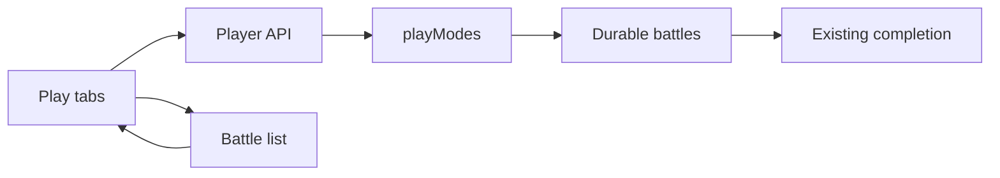
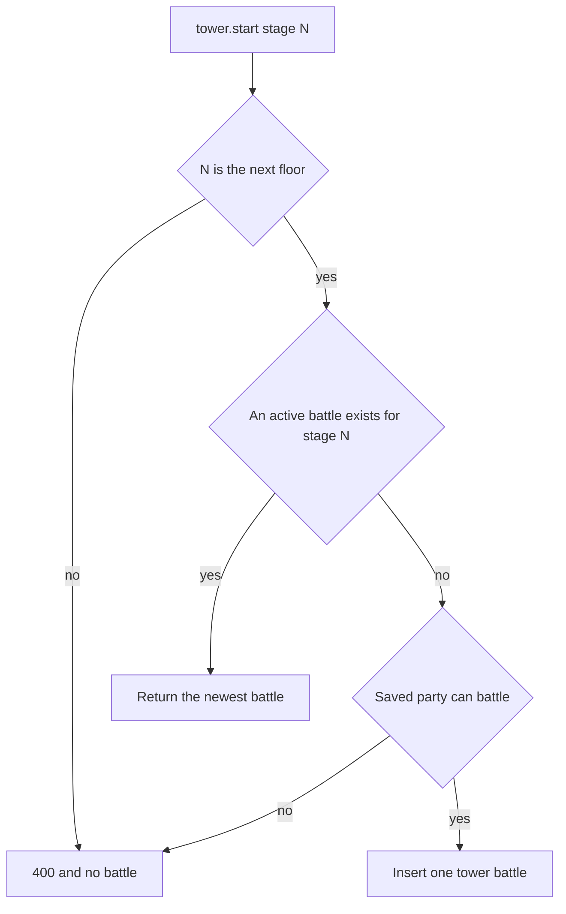
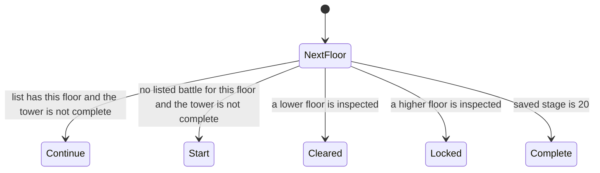

# Dungeons and Battle Tower on Play - Plan

## Goal Capsule

- Objective: A player can enter a dungeon or the current Battle Tower floor from Play, using the party they already saved, and can return to a tower floor that is already open.
- Means: Authenticated catalog and start operations beside the trainer NPC path. The current tower floor returns an existing battle when one is already active (KTD1, KTD2).
- Authority: The play-modes study and the choices confirmed for this plan. Party validation, battle revisions, ordered events, and the completion claim stay authoritative. `docs/design/play-modes/README.md` still calls itself a proposal; this plan replaces that sentence for this scope.
- Delivery: One implementation branch that already contains the study, the dungeon subtitles, and the item images. Do not append this work to the unpublished NPC feature commits.
- Stop conditions: Stop if a current-floor start that can already see an active battle for that floor inserts another one, or if the page would grant completion rewards. Two requests that both see no battle, and a Discord accept beside a web start, stay accepted. Copy, spacing, and test names do not need another approval.

## Product Contract

### Summary

Play gains the two remaining battle tabs, Dungeons and Battle Tower, from the approved study.
Dungeons list Mind Temple, Soul Cave, Spirit Altar, New Island, and Mount Coronet.
Battle Tower opens on the next floor the player is allowed to fight, or on floor 20 with the action disabled when that floor is already cleared.
Master Ball rewards use the Master Ball image.
Money uses the ruble mark the bot already prints.

### Problem Frame

Trainer battles can already be started on Play.
Dungeons and the Battle Tower are still marked Later, so those fights still begin in Discord.
The tower is not a free repeat of the trainer start. A win that runs after the stage has already moved fails completion: it does not pay the floor, does not grant battle experience, and does not advance the tower.

### Requirements

**Catalog and screen**

- R1. Dungeons and Battle Tower are usable Play tabs. The five dungeons appear in Discord menu order, and each row uses the subtitle stored on that dungeon.
- R2. A dungeon detail is one Pokémon list. Bosses use the same red border as trainer aces. The header sits on a dimmed, cropped location image and grows with the title and description. If that image fails, the title and description stay and the image is removed.
- R3. Battle Tower opens on the next floor. When floor 20 is already cleared, it opens on floor 20 with the action disabled. The levels shown are the range the fight generates.
- R4. Continue names a dungeon by its display name and difficulty, and a tower battle by its floor number.

**Starts**

- R5. A start names the dungeon and difficulty, or the tower floor. The server uses the signed-in player and the saved party. The request does not carry a party or a player id.
- R6. Starting a dungeon always creates another battle, including when that dungeon is already open. Each victorious battle can grant its configured rewards again. This screen does not show the New Island Mew sentence and does not claim Mew.
- R7. Starting the current tower floor returns the newest active battle for that floor when one exists, and creates a battle only when none exists. Any other floor is rejected. A completed tower cannot be started.
- R8. The current floor's button is a Continue link when an active battle for that floor is listed and the tower is not complete. When the tower is not complete and no active battle for that floor is listed, that floor can be started. When the tower is complete, the action is disabled and a start creates nothing. Cleared, next, and locked follow the saved tower stage, not the presence of some other tower battle. A floor below the next one is cleared. A floor above it is locked.
- R9. A start shows the same pending state as a trainer start. A rejected dungeon, difficulty, or floor is a definite failure and the catalog reloads. A lost response or an unavailable battle keeps the trainer notice that the battle may have started.

**Rewards and marks**

- R10. Completion still grants once per battle through the existing claim. A tower win that runs after the saved stage has already moved throws before rewards are copied, so that battle grants neither the floor payout nor battle experience, does not advance the tower, and the battle screen shows the existing failed-completion notice: "Reward processing needs manual review. Your battle result is saved." Opening a finished battle does not grant again. Two completions that both read the old stage before either write can both pay. This plan does not add a conditional stage update.
- R11. Money on these screens is the ruble mark plus a grouped amount. A Master Ball reward uses the Master Ball image. Auto and Dream Cards stay off these screens.

### Key Decisions

- One Pokémon list, not phases. (session-settled: user-directed — chosen over phase-by-phase strips: the phase list made the phone page too long.) Governs R2.
- Subtitles live on the dungeon config. (session-settled: user-directed — chosen over text written only in the page: one config feeds Discord's neighbors and the web catalog.) Governs R1.
- The header sits on a dimmed cropped location image. (session-settled: user-directed — chosen over a title stacked above a separate image: the title and description need a gap before difficulty, and a small image still has to fill the header.) Governs R2.
- Battle Tower opens on the current floor. (session-settled: user-directed — chosen over the floor list as the landing view: the player came to fight the floor they are on.) Governs R3, R8.
- An already-open current floor continues that battle. (session-settled: user-approved — chosen over starting a second battle: a win after the stage has moved fails completion and does not advance the tower.) Governs R7, R8.
- Shown floor levels are the ones the fight generates. (session-settled: user-approved — chosen over Discord's climbing captions and over retuning the fights: the captions disagree with the teams, and the fights stay as they are. Conflict: floor 1's caption is 40–50 while the fight is 42–52; floor 20's caption is 194–204 while the fight is 100–120.) Governs R3.

### Key Flows

- F1. Current tower floor
  - **Trigger:** The player opens Battle Tower or uses the gold control on the next floor.
  - **Steps:** The catalog read applies the fortnight reset. The screen opens on the next floor, or on floor 20 when that floor is already cleared. Continue links to the newest listed battle for the next floor and does not send a start (R8). Start sends the floor only when that battle is absent (R7). A floor that is not next is rejected (R7, R9).
  - **Outcome:** One new battle for the next floor, or the existing one. Other tower battles stay on Continue and do not change which floor is next.
  - **Covered by:** R3, R7, R8, R9, R10

### Acceptance Examples

- AE1. Current floor already open. Given the saved tower stage is 6 and an active tower battle exists for floor 7, opening Battle Tower shows Continue. That control opens floor 7 and does not send a start. Covers R7, R8.
- AE2. Current floor not open. Given the saved tower stage is 6 and no active battle exists for floor 7, Start creates a floor 7 battle. Floor 8 says to clear floor 7 first and cannot start. Covers R3, R7, R8.
- AE3. Tower already finished. Given the saved tower stage is 20, the screen opens on floor 20 and the action is disabled. A start of floor 20 creates nothing. Covers R3, R7.
- AE4. Dungeon rematch. Given Mind Temple is already active, Start creates another Mind Temple battle. Both can be won, and each victory can grant that battle's rewards. Covers R6, R10.
- AE5. Stale floor. Given the saved tower stage is 6, a start of floor 8 creates nothing, pays nothing, and the screen treats it as a definite failure and reloads the catalog. Covers R7, R9, R10.
- AE6. Marks and levels. Floor 1 shows levels 42–52. Floor 20 shows levels 100–120. A Master Ball reward shows the Master Ball image. A money reward shows the ruble mark and grouped digits, such as ₽10,000. Covers R3, R11.
- AE7. Cleared floor. Given the saved tower stage is 6, inspecting floor 5 shows Cleared and sends no start. Floor 8 shows Locked. Covers R8.

### Scope Boundaries

- The five live dungeons and all 20 tower floors are in this work. Commented dungeon ids are not.
- Auto, Dream Cards, equipment, claiming Mew, and saved-result replay stay out.
- Discord's dungeon and tower commands keep their current send functions.
- Tower team generation is not retuned. `battleTowerConfig` level captions are not what the screen shows.
- No start reservation, unique floor index, or new reward ledger is added.

### Deferred to Follow-Up Work

- Making Discord's tower accept return an existing battle. Until then, Discord can still insert a second battle beside a web one.
- Closing or hiding older duplicate tower battles. They remain on Continue. A win that runs after the stage has moved fails completion (R10).
- Rehosting remote dungeon location art. A failed image drops out of the header (R2).
- Exactly-once participation grants. Separate requests can still each receive the existing 5 EXP and 10 money (KTD3).

### Sources

- `docs/design/play-modes/`: approved layout, subtitle fixtures, and the generated level comparison. The study is not shipped in the client bundle.
- `src/config/npcConfig.js`: dungeon subtitles, dungeon rewards, and `battleTowerConfig`. Discord embeds do not read `subtitle`.
- `src/services/npcBattle.js` and `src/services/player.js`: the trainer catalog, `npc.start`, and the participation grant after a successful interaction.
- `src/services/battle.js`: `applyDurableTowerCompletion` throws `Tower stage changed` before copying rewards when the saved stage is no longer one behind the battle.
- `src/battle/engine/npcs.js`: `TowerNPC` uses the linked NPC difficulty levels and ignores the tower row's own level fields.
- `src/battle/service/BattleWebService.js`: active summaries keep `npcId` and `difficulty` only for `pve`. Dungeon id and tower stage are dropped.
- `docs/web-player-operations.md`: 5 EXP and 10 money per successful gameplay request. Local navigation and catalog polling do not grant.
- `docs/plans/2026-11-02-1847-feat-npc-battle-start-plan.md`: trainer duplicates are acceptable. That acceptance does not extend to the current tower floor.
- `docs/efforts/web-parity-coverage.md`: G17 / #211 and G18 / #212. G17's "once" matches the per-battle claim, not a lifetime dungeon lock (R6, R10). G18 was marked Later; this plan includes it.

---

## Planning Contract

### Key Technical Decisions

- KTD1. Add `src/services/playModes.js` next to `src/services/npcBattle.js`. It builds the catalogs and the battles. HTTP does not call `buildDungeonSend`, `buildBattleTowerSend`, or `onBattleTowerAccept`. Those functions need Discord component state and would surface Auto and Dream Cards.
- KTD2. After the requested floor is confirmed to be the next floor, load that player's active battles and return the newest `updatedAt` whose mode is `tower` and whose stage is that floor. Tie-break on battle id. Do not insert, and do not close the others. Two requests that both see none can both insert. Discord's accept handler is unchanged. (session-settled: user-approved — chosen over starting a second battle: a win after the stage has moved fails completion and does not advance the tower.) Implements R7, R8.
- KTD3. Add `GET /player/dungeons` and `GET /player/tower`. Both read the trainer through the same path that applies the fortnight reset, and neither goes through `interact`. Add `dungeon.start` with `{ kind, dungeonId, difficulty }` and `tower.start` with `{ kind, stage }` where `stage` is a JSON number. Extra keys, a string stage, or a client player id are `invalid_interaction`. A successful POST grants 5 EXP and 10 money, including a tower POST that only returns an existing battle. A grant failure is logged and still returns the battle id. The Continue link and the catalog reads do not grant. This follows the selected interaction boundary in `docs/web-player-operations.md` rather than skipping pay on a resume.
- KTD4. `BattleWebService.listActive` adds `dungeonId` and `difficulty` when the mode is `dungeon`, and `stage` when the mode is `tower`. It does not copy `battleTowerStageN` into `npcId`, and it does not return the raw mode object.
- KTD5. Check the floor before the party. An unknown dungeon is `invalid_dungeon`. An unknown difficulty is `invalid_difficulty`. An unknown floor is `invalid_stage`. A known floor that is not the next floor, including floor 20 after a clear, is `tower_not_current`. Those are HTTP 400 and create nothing. Party failures on a new insert stay `invalid_party`. A trainer read failure is `trainer_unavailable` at 503. The client uses a definite notice and refetches the catalog for the 400 codes. It keeps the existing "may have started" notice for transport loss and 503. Returning an existing tower battle does not re-check the party.
- KTD6. Tower level rows use the linked NPC difficulty, from `minLevel` through `maxLevel + 1`, the same span `projectNpcCatalog` already uses. They do not use `battleTowerConfig` `minLevel` / `maxLevel`. (session-settled: user-approved — chosen over Discord's climbing captions and over retuning the fights: the captions disagree with the teams.) Implements R3.
- KTD7. Map backpack item id `"3"` to `master-ball.png`. Copy `extra_data/images/items/master-ball.png` into `web/public/images/items/master-ball.png`. There is no Pokedollar image. Money is the character `₽` plus en-US grouping, matching `formatMoney` in `src/utils/utils.js`. A missing item file keeps the name and count and uses the existing `◆` mark. Do not change the account page's money icon.
- KTD8. Play view ids are `dungeons` and `tower`. Query keys are `dungeon`, `difficulty`, and `floor`. An unknown view still collapses to the current default. Dungeon order is `Object.values(dungeons)`, not `dungeonConfig` insertion order. An unknown dungeon or floor falls back to the default selection and does not 404 the page. The reset line is the next epoch-aligned 14-day UTC boundary, computed on the client from the same divisor as `getFullUTCFortnight`. It is not a server field and it is not the study's sample "9 days".

### High-Level Technical Design

The page reads catalogs and the active-battle list. Starts go through the player interaction boundary into the new module, then the existing durable battle service. Completion is unchanged.

Floor flags come only from the saved tower stage. The start path rejects anything that is not the next floor before it looks for an open battle or checks the party.

The gold control follows the list, not the insert rule. Continue is a link. Start is the POST.

### Assumptions

- The implementation branch already contains `docs/design/play-modes/`, the `subtitle` fields on the five live dungeons, and the shard, Mew, and star images under `web/public/images/items/`. If those are missing, bring them onto the branch before building the screens.
- `extra_data/images/items/master-ball.png` is available from the main checkout. If that file is missing, stop. Do not substitute another ball.
- A concurrent double insert, or a Discord accept beside a web start, can still leave a second active battle. A win that runs after the stage has already advanced fails completion (R10). Two completions that both read the old stage before either write can both pay. That overlap stays accepted.
- `docs/efforts/web-battler.md` still describes the study as waiting for feedback. The implementer records the approval when the behavior lands. Until then, this plan is the decision.

### System-Wide Impact

- The player API grows two reads and two start kinds. Session actor, account mismatch, rate limits, and `DURABLE_BATTLES_ENABLED` stay as they are for `npc.start`.
- The active-battle summary grows allowlisted fields. Older clients that ignore unknown fields still show the generic "Dungeon" and "Battle Tower" labels.
- Discord commands, `applyDurableTowerCompletion`, and `processBattleCompletionRewards` are not edited.
- A tower POST that finds an existing battle still pays the interaction grant (KTD3). That is participation money, not the floor's configured reward.

### Risks & Dependencies

- The costly failure is a second current-floor battle. KTD2 removes it for a single web request that can see the existing row. It does not remove a race or a Discord accept.
- After a fortnight reset, an old floor can still be active. It stays on Continue. The tower opens on floor 1 with Start. Winning the old floor fails completion (R10).
- Several dungeon location URLs already fail in the browser. The header has to stay readable without them (R2).
- G18 is still marked Later in `docs/efforts/web-parity-coverage.md`. This plan includes the tower because both tabs were confirmed. Update that mark when the work lands, so a later reader does not treat the tower as deferred.
- Backend `checkJs` already reports 498 diagnostics. New errors are failures. A run that only hides the old ones is not a pass.

### Sequencing

U1 lands the catalogs and the Master Ball file. U2 adds starts on that module. U3 widens the battle list. U4 builds the tabs after all three, because the screen needs the catalogs, the start kinds, and the floor field together.

---

## Implementation Units

### U1. Dungeon and tower catalogs

- **Goal:** The signed-in player can read both catalogs, with subtitles, one Pokémon strip, generated tower levels, and reward marks.
- **Requirements:** R1, R2, R3, R11
- **Dependencies:** The study, subtitle fields, and existing item images are on the branch.
- **Files:**
  - `src/services/playModes.js`
  - `src/services/__tests__/playModes.test.js`
  - `src/services/player.js`
  - `src/web/playerApi.js`
  - `src/web/__tests__/playerApi.test.js`
  - `web/public/images/items/master-ball.png`
  - `web/public/images/items/README.md`
- **Approach:**
  - Project dungeons in `Object.values(dungeons)` order. Copy `subtitle` from `dungeonConfig`. Flatten phases into one species list, bosses first, marked from `dungeon.bosses`.
  - Project each tower floor's opponent from the linked NPC difficulty. Levels follow KTD6. Include `lastTowerStage` from the trainer read that applies the fortnight reset.
  - Reward rows reuse the trainer icon map and add KTD7. Money is a ruble amount, not an item file.
  - Mount the two GETs beside `GET /player/npcs`. They require a session and grant nothing.
- **Patterns to follow:** `projectNpcCatalog` in `src/services/npcBattle.js`. `docs/design/play-modes/generate-fixtures.cjs` for menu order and the fight-level fields.
- **Test scenarios:**
  - A signed-out catalog request is rejected. A signed-in request returns Mind Temple first and Mount Coronet last, each with its configured subtitle.
  - Spirit Altar's species list includes every phase's Pokémon once, with bosses identified, and does not include a phase list.
  - Floor 1 reports levels 42–52. Floor 20 reports levels 100–120. The tower row's own 40–50 and 194–204 captions are not the reported range.
  - A Master Ball reward uses `master-ball.png`. Floor 1 money is the ruble amount for 250. Floor 20 money is the ruble amount for 10000.
  - The catalog response includes the trainer's `lastTowerStage`. A read does not grant 5 EXP or 10 money.
  - An unknown route stays unauthorized without a session.
- **Verification:** The catalog tests pass, and a direct read of the five subtitles matches `dungeonConfig`.

### U2. Dungeon and tower starts

- **Goal:** A dungeon start always creates a battle. A current-floor tower start returns an existing battle when one is active, and otherwise creates one.
- **Requirements:** R5, R6, R7, R9, R10
- **Dependencies:** U1
- **Files:**
  - `src/services/playModes.js`
  - `src/services/__tests__/playModes.test.js`
  - `src/services/player.js`
  - `src/services/__tests__/player.test.js`
  - `src/web/__tests__/playerApi.test.js`
- **Approach:**
  - Load the trainer and validate the saved party the way `buildNpcBattle` does, then return a battle or a code. Do not copy that helper's battle body. A dungeon battle uses `DungeonNPC`, `npcType` `dungeon`, that difficulty's rewards and reward string, and queues the remaining phase parties. A tower battle uses `TowerNPC`, `npcId` `battleTowerStageN`, `npcType` `battleTower`, a null win callback, and no rewards copied from the linked NPC's daily rewards. Do not copy Auto or Dream Card fields. Dungeon mode is `{ type: "dungeon", dungeonId, difficulty }`. Tower mode is `{ type: "tower", stage }`.
  - Follow KTD2 and KTD5. Do not look up an existing dungeon battle.
  - Grant only from the interaction boundary, per KTD3. Do not edit `applyDurableTowerCompletion`.
- **Execution note:** Prove the tower resume and the rejected floor with failing service tests before wiring the route. An insert on the resume path is the failure this unit exists to prevent.
- **Patterns to follow:** `npc.start` in `src/services/player.js`. Durable mode shape in `src/services/__tests__/durableModeStarts.test.js`.
- **Test scenarios:**
  - A dungeon start with a saved party of one eligible Pokémon returns a new battle id, mode `{ type: "dungeon", dungeonId, difficulty }`, that difficulty's rewards, and one fewer queued phase party than the dungeon has phases. It does not carry the linked NPC's daily rewards. A second start for the same dungeon returns a different id.
  - An empty party, a duplicate party id, and a species that cannot battle each return `invalid_party` and no battle.
  - An unknown dungeon returns `invalid_dungeon`. An unknown difficulty returns `invalid_difficulty`. Neither grants participation.
  - With saved stage 6 and an active floor 7 battle, `tower.start` for 7 returns that battle id and does not insert. A second, older floor 7 battle is left active. The returned id is the newer one.
  - With saved stage 6 and no floor 7 battle, `tower.start` for 7 inserts mode `{ type: "tower", stage: 7 }`, `npcId` `battleTowerStage7`, `npcType` `battleTower`, and a null win callback. The battle does not carry the linked NPC's daily rewards.
  - Stage 8 with saved stage 6 returns `tower_not_current` before the party is checked, even when the party is empty. Stage 20 with saved stage 20 does the same. Stage 21 returns `invalid_stage`. A string stage is `invalid_interaction`.
  - A successful dungeon insert and a tower resume each grant 5 EXP and 10 money. A logged grant failure still returns the battle id. A 400 returns no grant.
  - The HTTP body `{ kind: "tower.start", stage: 7 }` reaches the service for the session player. A body that also includes a player id is `invalid_interaction`.
- **Verification:** Resume does not insert. A rejected floor does not insert and does not pay. Existing tower completion tests still show one advance from stage 0 to stage 1.

### U3. Continue names

- **Goal:** The active-battle list carries enough to name a dungeon and a tower floor, and the Continue tab uses those names.
- **Requirements:** R4, R8
- **Dependencies:** U1
- **Files:**
  - `src/battle/service/BattleWebService.js`
  - `src/battle/service/__tests__/BattleWebService.test.js`
  - `web/src/battles/types.ts`
  - `web/src/battles/BattleList.tsx`
  - `web/src/play/PlayFeature.test.ts`
- **Approach:**
  - Extend the summary with KTD4 only.
  - Resolve names on the client from the dungeon and tower catalogs. A missing catalog row keeps "Dungeon" or "Battle Tower". Two battles for one floor are two rows.
  - A tower row whose stage is not the next floor does not change Cleared, Next, or Locked. A tower row with no stage stays "Battle Tower" and does not turn the gold control into Continue.
- **Patterns to follow:** The existing `pve` allowlist and its test that a pvp summary drops extra mode fields.
- **Test scenarios:**
  - A dungeon summary includes `dungeonId` and `difficulty` and does not include unrelated mode fields.
  - A tower summary includes `stage` and does not include `npcId` `battleTowerStage7`.
  - A pvp summary remains `{ type: "pvp" }`.
  - With both catalogs loaded, Continue shows "Mind Temple · Hard" and "Battle Tower · Floor 7".
  - With no dungeon catalog match, the row says "Dungeon". A tower summary with no stage says "Battle Tower".
- **Verification:** The allowlist test fails if a raw mode object or a tower `npcId` is returned.

### U4. Play tabs

- **Goal:** A player can open either tab, inspect a dungeon or floor, and start or continue from the approved layout.
- **Requirements:** R1, R2, R3, R8, R9, R11
- **Dependencies:** U1, U2, U3
- **Files:**
  - `web/src/play/PlayFeature.tsx`
  - `web/src/play/play.css`
  - `web/src/navigation/routes.ts`
  - `web/src/navigation/routes.test.ts`
  - `web/src/player/PlayerData.ts`
  - `web/src/player/PlayerData.test.ts`
  - `web/src/player/types.ts`
  - `web/src/play/PlayFeature.test.ts`
- **Approach:**
  - Enable the two tabs. Reuse the trainer pending button, party gate, and ace border class. Do not add Auto or Dream Cards.
  - The dungeon header keeps its text when the location image fails. Bosses use the existing ace border, not a second red.
  - Tower flags follow KTD8 and the state diagram. Continue is a link to the newest listed battle whose stage equals the next floor. Start posts only that floor.
  - Poll the tower catalog on the same cadence as the battle list. Do not let one response rewrite the other.
  - Keep `docs/design/play-modes/` out of the production bundle.
- **Patterns to follow:** `web/src/play/PlayFeature.tsx` trainer selection, pending mutation, and party pop-out. `docs/web-ui-style-guide.md` for copy and Jewel surfaces. `docs/design/play-modes/study.css` for the dimmed header and the gap before difficulty.
- **Test scenarios:**
  - Opening Play with no view still prefers Continue when battles exist, and Trainer battles when they do not.
  - The Dungeons tab selects Mind Temple. A `dungeon` query selects that dungeon. An unknown dungeon id falls back to Mind Temple.
  - The tower tab with saved stage 6 selects floor 7. Floor 5 shows Cleared and does not start. Floor 8 shows Locked and says to clear floor 7 first. Floor 20 with saved stage 20 has a disabled action, and the floors below it show Cleared.
  - With an active floor 7 battle and saved stage 6, the gold control is Continue and the start mutation is not called. With no such battle, Start sends `{ kind: "tower.start", stage: 7 }`.
  - While the start is pending, the button is busy and the floor or difficulty controls are disabled. After `tower_not_current`, the catalog refetches and the notice is not the "may have started" sentence. After a network failure, that sentence remains and Start can be used again.
  - An empty party disables Start and leaves Continue usable.
  - A failed location image leaves the dungeon title and description visible.
  - Polling the battle list does not change the dungeon or floor the player is inspecting.
- **Verification:** Client tests cover the examples above. A browser pass on desktop, 390px, and 320px walks a dungeon start, a locked floor, Continue on an open floor, a party that cannot start, and a dungeon whose location image fails.

---

## Verification Contract

| Check | Command | Done when |
| --- | --- | --- |
| Catalog, start, and list | `npm test -- src/services/__tests__/playModes.test.js src/services/__tests__/player.test.js src/web/__tests__/playerApi.test.js src/battle/service/__tests__/BattleWebService.test.js` | U1–U3 backend scenarios pass. U3's Continue names are proved by the Client row |
| Existing tower behavior | `npm test -- src/services/__tests__/durableModeStarts.test.js src/services/__tests__/battleCompletion.test.js` | Durable mode shape and one floor advance still hold |
| Shared services | `npm test` | The full backend suite passes. These units touch the player service and the battle list |
| Types | `npm run typecheck` | No new `checkJs` diagnostic beyond the 498 already reported |
| Lint | `npm run lint -- src/services/playModes.js src/services/player.js src/web/playerApi.js src/battle/service/BattleWebService.js` | No new lint on the touched backend files, plus their tests if those files are linted with them |
| Client | `npm test --prefix web` and `npm run build --prefix web` | Play, routes, and the production bundle pass |
| Browser | Desktop, 390px, and 320px | U4's browser walk holds. The study's earlier screenshots are not this proof |

Real MongoDB, Discord OAuth, and a second device are not proved by these commands. Say so if they were not exercised.

---

## Definition of Done

- R1 through R11 hold, and U1 through U4 meet their verification lines.
- A current-floor start that already sees an active battle for that floor returns it and does not insert. Two requests that both see none can still insert two battles.
- A dungeon start still creates another battle.
- The page does not grant completion rewards, and `applyDurableTowerCompletion` is unchanged.
- Abandoned experiments are not left in the diff.
- `docs/efforts/web-battler.md` records the landed behavior separately from the old proposal. `docs/design/play-modes/README.md` no longer tells the next reader that this scope is waiting for approval. G18 is no longer described as later work that this plan deferred.
- The design study is not part of the client bundle.
