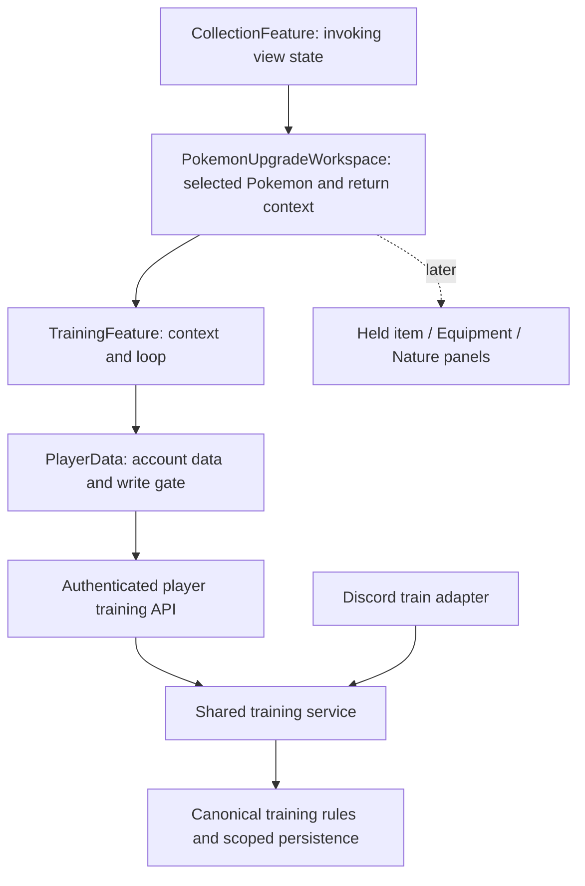
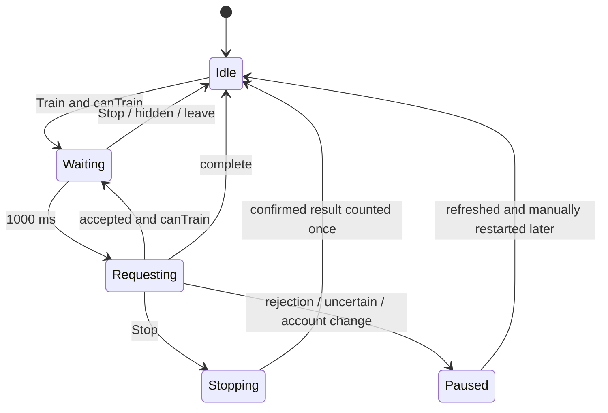

# Pokemon Training and Upgrade Workspace - Plan

## Goal Capsule

- **Objective:** Players can train an owned Pokémon and rebuild its EVs without repeatedly clicking or sending Discord commands.
- **Means:** The approved Pokémon-scoped upgrade workspace and a browser-owned training loop over shared training rules (R1–R7, KTD1–KTD4).
- **Authority:** Current maintainer instructions, the approved training study, this Product Contract, then the Planning Contract. The study is a visual reference; its simulated math and fixture navigation are not production contracts.
- **Execution profile:** One implementation PR for #204, with the dependency-ordered units below. Reuse the current checkout; use a separate implementation branch from the verified bag prerequisite rather than adding commits to PR #257. Preserve the untracked bag study/plan and the training study.
- **Stop conditions:** Do not implement adjacent upgrade features or change training yields. Stop publication if checks expose a new repeatable progression-loss or ownership defect.
- **Finish and ship:** The current request authorizes planning and the study's chevron repair. Implementation, commits, push/PR and deployment require a subsequent instruction; production promotion retains the repository's existing acceptance gates.

---

## Product Contract

### Summary

Implement training as the first feature in an owned Pokémon's upgrade workspace, using the approved desktop and phone composition. Keep the workspace ready to add other upgrade tabs without implementing their behavior in this slice.

### Problem Frame

Training on Discord currently requires repeated `/train` commands. Players need the same progression rules through a browser interaction that continues until useful training at the selected location is complete or they stop it. The existing collection already owns selection and inspection; entering training should preserve that context.

### Requirements

**Entry and presentation**

- R1. Enter from an inspected owned Pokémon, without a standalone Train navigation destination or a Pokémon picker in training; Back and Pokémon navigation return to the invoking screen with its selection, query and view context intact.
- R2. Match the approved training study's identity, location list/native phone select, EXP meter, six EV rows, next-operation gains and reachable Train/Stop controls. Reserve text space and a 12 px right inset for the dropdown chevron.
- R3. Keep idle, stopped and completed status blank; show “Training…” while the loop is active or an already-submitted request is finishing. The training footer contains only total confirmed Pokémon EXP and signed EV gains.
- R4. Berry copy omits “down to zero”; Home explains that it provides the most EXP when fully upgraded. Unowned training locations remain unavailable; purchasing/upgrading them is outside this slice.

**Training behavior**

- R5. Train waits one second before its first request, permits one request in flight, then waits one second after each response before the next; slow requests never create a backlog or catch-up burst.
- R6. Stop cancels future requests, leaves an accepted request free to finish once, and keeps its actual returned gains. The button cannot restart or change location while that request is pending.
- R7. Stop when level is at least 100 and the selected location cannot change any EV. Positive EV gains and Berry reductions both count as EV changes; a cap in only one progression dimension does not stop the other. Stored EXP at level 100 remains governed by the unchanged backend.
- R8. Each accepted tick uses the current actor, owned Pokémon, location level, trainer-level multiplier and Celebi entitlement. Preserve per-stat/total EV clamps, leveling and TRAINED_POKEMON side effects; use actual operation deltas for totals.
- R9. Stop on rejection, rate limiting, lost ownership, session/account change or an uncertain result. Refresh after uncertainty and require a manual start; never replay an uncertain training mutation or invent gains from snapshot differences.
- R10. Pause on hidden tab, departure from Train, account disposal and unmount. Returning, reloading or browser Forward never automatically resumes. No offline queue or server training job.

**Future upgrade features**

- R11. The host owns the selected Pokémon, invoking-screen context and active upgrade feature; Train owns its locations, loop and totals. Later Held item, Equipment, Nature and other tabs must fit this host without moving training transport/timers into shared presentation.
- R12. Implement only Train now. Do not add inert future tabs, a generic feature registry, new upgrade mutations or item-spending flows merely to demonstrate extensibility.

**Participation rewards**

- R13. Each successful web training tick uses `/train`'s configured participation grant, currently 15 trainer EXP / 50 money, replacing the generic web 5 EXP / 10 money grant for this operation. Do not stack grants; reads, completion/no-op and rejected operations grant nothing.

### Key Decisions

- **One Pokémon context** (session-settled: user-directed — chosen over an independent training screen with Change: training belongs to the inspected Pokémon). Governs R1, R11.
- **Useful progression ends the loop** (session-settled: user-approved — chosen over counting indefinitely stored level-100 EXP: maximum level completes EXP, while EV changes remain useful). Governs R7.
- **Quiet controls and totals** (session-settled: user-directed — chosen over idle/stopped messages and a verbose session footer: only active training needs a status). Governs R3.
- **Training loop** (session-settled: user-directed — chosen over repeated manual bot commands: avoid spamming while retaining each operation's rules). Governs R5, R6, R8.

- **Match the bot training grant** (session-settled: user-approved — chosen over the generic web 5 EXP / 10 money policy: each training tick should match `/train` without stacking rewards). Governs R13.

### Acceptance Examples

- AE1. Covers R1, R11. Search/filter/page a collection, inspect Venusaur, open Train, and return using either Back or Pokémon: the invoking collection and selected Venusaur remain intact.
- AE2. Covers R3, R5, R6. Before 1,000 ms there is no training request; while waiting/in flight the status is “Training…”. Stop during a slow request accepts at most that one result, retains its gains and then clears the status.
- AE3. Covers R7. At level 99 with capped EVs, EXP training continues. At level 100 with room in the selected EV stat, EV training continues. At level 100 with no possible selected-location EV change, no further training write/event/grant occurs.
- AE4. Covers R7, R8. Berry Farm reduces existing EVs by the actual clamped signed deltas until zero; below level 100 it can continue for EXP. The EV-training quest still receives the existing absolute-delta contribution.
- AE5. Covers R8–R10. After an accepted write loses its response, pause, refresh current state without a grant and wait for manual Train. Do not count the uncertain response in session totals or resend it.
- AE6. Covers R10–R12. Leaving Train disposes its loop; a later upgrade tab can use the same selected Pokémon and return context without inheriting a running training session.

### Scope Boundaries

Required now: shared rule/service reuse, server authorization and projections, scoped training HTTP transport/quota, account-safe client data and loop, context-preserving upgrade host, the approved UI, and verification.

Preserve flexibility through a small host/feature seam and a single implemented feature ID. A future tab adds a panel and its own operation; it does not add another copy of Pokémon selection, account data or return navigation.

Considered and not built:

- Durable request receipts, exactly-once grants, replica-set migration, a global writer migration and distributed locks: the approved reliability amendment accepts existing rare cross-document/legacy-writer gaps. Do not promise these guarantees; revisit when repeatable loss or a spending operation requires them.
- Server/background/offline training and cross-tab leader election: R10 makes the visible browser own scheduling; per-account server quota bounds competing tabs. A real need for simultaneous unattended training would require a separate product decision.
- A generic upgrade plugin system or prebuilt future APIs: R11 needs only a host and a replaceable feature panel.

#### Deferred to Follow-Up Work

Nature/evolution/forms (#205), equipment upgrades/rerolls (#206), held items (#208), bag Mint/equip handoffs (#250/#251), equipment comparisons/transfers (#207), and location purchases (#202) keep their own designs, operations and acceptance. The panel-header extraction (#258) remains unrelated.

### Sources

- `docs/design/training/README.md`, `index.html`, `preview.html`, `study.js`, `study.css`, `collection.html` and `collection.js`: approved interaction/presentation and fixture limits. The maintainer confirmed annotations work unframed.
- Machine-local prototype source: `/Users/elviswei/.codex/worktrees/d66b/pokestar/docs/design/training/`. The README contains decisions; ready, home, berry, caps, slow and collection round-trip states matter. Best-effort while this checkout exists; missing study files are not a blocker and this plan's requirements govern disagreements.
- `docs/efforts/web-battler.md`; `docs/efforts/web-parity-coverage.md` G10; GitHub issue #204: journey scope and verification boundaries.
- `docs/design/owned-collection/architecture.md`, **Revised direction after maintainer feedback / Approved reliability scope**: current authority; the original transactional proposal below it is superseded.
- `src/services/pokemon.js`, `src/commands/pokemon/train.js`, `src/config/locationConfig.js`, `src/config/trainerConfig.js`, `src/config/commandConfig.js`, `src/handlers/commandHandler.js`: existing training and grant behavior.
- `web/AGENTS.md`, `docs/web-ui-style-guide.md`: visual/copy ownership and production review.

---

## Planning Contract

### Assumptions

The plan uses the existing React/TanStack Query and authenticated player API patterns, with no new dependency. Implementation is one PR based on the current prerequisite stack after verifying its branch state; no restack/retarget of existing PRs is implied. These are reversible implementation choices, not new user scope.

### Key Technical Decisions

- KTD1. **Share rule calculation and one training operation.** Extract the existing EV-clamp/EXP computation into a pure backend helper used by the write and its preview. A small training service resolves current trainer/owner/location and calls the shared rule path; Discord remains a formatting adapter. Preserve legacy formulas and the bot's default Home/single-command behavior (R7, R8).
- KTD2. **A training context is a pure read.** Add GET `/api/player/pokemon/:id/training`, returning owned detail and the nine supported training locations with ID, display/level/ownership, actual next EXP/signed EV deltas and `canTrain`. Exclude Computer Lab/Ilex Shrine. Evaluate R7 on the server without confusing stored level-100 EXP with useful progression. GETs, refresh and local navigation create no grant.
- KTD3. **Use a dedicated training mutation and quota.** Add POST `/api/player/pokemon/:id/train` with only `locationId` in the body, the existing session/origin/`X-Player-Id` protections, and an account-keyed `training` quota of 60 requests/minute. Keep the general API budget and other actions' 60/minute budget unchanged. This avoids a normal loop consuming party/battle/explicit-read action capacity. Two training tabs still share the training quota; 429 follows R9.
- KTD4. **Return applied gains and fresh state.** An accepted response contains actual EXP and six signed EV deltas, current detail/training context, actor and trainer profile. If a fresh precheck finds completion, return a non-mutating completion result with zero gains and no event/grant. Apply R13 from the canonical `/train` command configuration; Discord keeps command-handler grants. Generic `/interactions` grants stay unchanged.
- KTD5. **Protect touched training writes without a general migration.** Training must not persist a stale full Pokémon/trainer snapshot every second. Persist only progression/derived Pokémon fields, with ownership and observed progression/build inputs guarding the write. A conflict pauses/refreshes; do not retry callbacks with events or grants. TRAINED_POKEMON persists its actual quest-data changes without replacing money, party, inventory or profile. Keep this scoped to training; other progression callers retain their current behavior. Preserve the existing cross-document partial-failure limitation.
- KTD6. **Keep one account-owned data layer.** Extend `PlayerData` with the context query and training operation, retaining its actor envelope, epoch checks, shared write exclusion, mutation `retry: false` and request timeout. Install each accepted detail/trainer/context response and patch matching cached summaries; mark membership/sort-sensitive collection/party reads stale and refresh them when training stops/closes. Do not refetch the entire account or blank panels after each tick.
- KTD7. **Keep the invoking collection mounted.** Host the upgrade workspace inside `CollectionFeature`, preserving its query, selection, sheet state, label/sort/filter state, scroll and focus while visually replacing its workspace. Use a Pokémon-owned subview parameter such as `upgrade=train` together with `owned=<id>` under `#pokemon`; normalize unsupported/missing-context values back to collection. Same-context reload may reopen an idle panel, never a running loop. Back/Forward and the Pokémon navigation link must use the same close/return behavior (R1).
- KTD8. **Make the future-tab seam small.** Add `PokemonUpgradeWorkspace` for identity/return/active-feature placement, with `TrainingFeature` for querying, mutations and loop lifetime and `TrainingPanel` for display. Start with only the implemented Train feature; future tabs extend this host and stop Train by unmount/deactivation. Do not route all Pokémon upgrades through a training-specific service or create speculative registries (R11, R12).

### High-Level Technical Design





```mermaid
sequenceDiagram
  participant UI as Browser loop
  participant API as Training API
  participant S as Shared service
  participant DB as Owned state
  UI->>API: One tick after 1s
  API->>S: Session actor, Pokemon ID, location ID
  S->>DB: Fresh trainer and owned Pokemon
  S->>S: Validate location and useful progression
  S->>DB: Guarded progression patch
  S->>DB: Training event effects and one participation grant
  S-->>API: Applied gains and current projection
  API-->>UI: Actor-scoped result
  UI->>UI: Install state; wait 1s or stop
```

### Data, Effects and Failure Boundaries

`addPokemonExpAndEVs` currently recalculates then `$set`s the Pokémon snapshot. `trainPokemon` emits TRAINED_POKEMON, and `emitTrainerEvent` currently delegates to a whole-trainer `updateTrainer`. The EV quest listener contributes the sum of absolute signed deltas. These are concrete touched paths behind KTD5, not a reason to migrate every writer.

Guard the progression inputs used to compute the candidate, including EXP/level/EVs and species/nature/IV/equipment inputs to derived stats. A rejected conditional write has no training event or grant. Preserve unrelated nickname, lock, held-item, ownership and equipment fields rather than persisting them from the candidate snapshot. One committed Pokémon write can still be followed by an event/grant failure: expose saved gains with a side-effect warning and pause, without replaying the Pokémon write. No transaction or durable receipt is claimed.

The client derives totals only from accepted results received in the current Train session. Refresh can reveal newer saved progress, but does not recover an unseen per-operation delta or retroactively add it to totals. Error/side-effect warnings live in the existing callout pattern; R3 still governs the ordinary status/footer.

### Navigation and Query Lifetime

Use the existing lightweight URL/history route system. Preserve the hosting base path, unrelated query parameters and selected owned Pokémon. Navigating away from Pokémon removes the upgrade subview; clicking Pokémon while its upgrade view is open closes it rather than linking back to Train. A fresh URL without a valid owned context cannot open a global training screen.

Location changes are disabled only while running/finishing. During a loop, suspend target-context polling and the hidden collection's ordinary queries; accepted responses supply fresh per-tick data. On pause/stop, refresh the affected queries once. A response arriving after a stop is still usable once if the actor/epoch/context are current; a response for an old account or obsolete Pokémon/feature never updates the new one. The scheduler checks its generation again after every asynchronous boundary before scheduling another request.

---

## Implementation Units

### U1. Characterize and share canonical training calculations

- **Goal:** Preview and applied training use one calculation without altering game rules (R7, R8; KTD1, KTD2).
- **Files:** `src/services/pokemon.js`; new `src/utils/trainingUtils.js`; `src/config/locationConfig.js` only for a shared trainable-location allowlist; new `src/services/__tests__/trainingRules.test.js`.
- **Approach:** Characterize the current addPokemonExpAndEVs behavior before extracting its pure EXP/EV calculation. Keep level/growth and stat derivation at their existing server sources. Copy input EV arrays; calculate signed deltas without mutating catalog configuration or a read projection.
- **Patterns:** Existing `findOwnedPokemon`/`projectPokemonDetail`, configured constants and repository Jest helpers.
- **Test scenarios:**
  1. Free Home yields base 2 EXP; owned Home and all six positive-EV facilities use configured levels; invalid/non-training locations are rejected.
  2. Trainer-level multiplication, floor/minimum EXP and Celebi ×2 match the legacy calculation.
  3. A near-252 stat and near-510 total produce actual partial positive deltas; capped EVs below level 100 still permit training.
  4. Berry reductions at positive, near-zero and zero EVs match the current six-stat order and clamps, including absolute-delta quest input.
  5. Level-100 projection follows R7 while the underlying applied operation retains stored EXP behavior; crossing a growth threshold updates level/stats correctly.
  6. The helper leaves input records, EV arrays and location configuration unchanged.
- **Verification:** Characterization and new helper agree at all named boundaries. Mocked rule tests do not establish persistence.

### U2. Share the owned training operation and narrow its writes

- **Goal:** Both surfaces train through the same validated operation while retaining Discord behavior (R7–R9; KTD1, KTD4, KTD5).
- **Files:** new `src/services/training.js`; `src/services/pokemon.js`; `src/services/trainer.js` and `src/services/quest.js` only for scoped training-event persistence; `src/commands/pokemon/train.js`; new `src/services/__tests__/training.test.js`; new `src/commands/pokemon/__tests__/train.test.js`.
- **Approach:** Resolve current trainer/owned Pokémon/location per operation. Separate raw rule application from Discord prose and HTTP projection. Scope the guarded/narrow writes in KTD5 to training; no universal persistence framework. Discord keeps its one-command/default-Home behavior, configured participation handled by the command handler, and existing result/level-up wording.
- **Test scenarios:**
  1. A foreign, released or malformed Pokémon ID and an unowned/invalid location produce no write, event or grant.
  2. A fresh web completion precheck returns the KTD4 no-op result; bot commands retain their existing single-operation behavior at level 100.
  3. A nickname/held-item/inventory/party update between read and write survives; a progression/build-input conflict is rejected before event/grant.
  4. TRAINED_POKEMON fires once for the committed deltas, including negative Berry EVs; its persistence does not replace unrelated trainer resources or party.
  5. A Pokémon write followed by an event persistence failure returns confirmed primary gains plus a warning, without retrying or rolling back the already-applied gain.
  6. Slash/message defaults, explicit locations, level-up text and the command-handler grant remain compatible and do not double-award.
- **Verification:** Service tests catch sequencing and scoped-write behavior; command tests catch adapter compatibility. Real Mongo checks in U6 establish actual conditional updates.

### U3. Add authenticated training context and mutation transport

- **Goal:** Expose training with authoritative eligibility, one participation policy and an independent account quota (R2, R7–R9, R13; KTD2–KTD4).
- **Files:** `src/services/player.js`; `src/web/playerApi.js`; `src/web/rateLimits.js`; `src/web/__tests__/playerApi.test.js`; `src/web/__tests__/rateLimits.test.js`; `src/services/__tests__/player.test.js`; shared DTO typedefs in `types.js` when needed.
- **Approach:** Add the two KTD2/KTD3 routes to the existing actor/session/origin boundary. Strictly allowlist the body and nine location IDs. Use server grants only after confirmed accepted progression, never the generic `/interactions` grant as well. Read the grant from the existing `/train` command configuration under R13. Return authoritative next gains and actor/profile envelope; refresh and no-op completion are ungranted.
- **Test scenarios:**
  1. Missing session, wrong origin, wrong X-Player-Id, foreign Pokémon and extra payload fields fail before side effects.
  2. Context GET returns exact owned locations/levels, free Home, clamped signed gains, useful-progression eligibility and current detail without granting.
  3. An accepted tick grants 15 trainer EXP / 50 money once under R13; a failed grant does not rerun training or add the generic grant.
  4. Completion/no-op and rejected operations have no participation grant or TRAINED_POKEMON event.
  5. Sixty training requests are allowed in a minute, the next returns 429, another account has a separate quota, and other action budgets remain independent.
  6. A concurrent trainer level/Celebi/location change affects a subsequent tick's server-derived gain, not a browser-held multiplier.
- **Verification:** HTTP tests establish middleware/envelope/budget contracts; service tests establish grants and projection. They do not establish OAuth or real-database acceptance.

### U4. Add account-safe training data and loop lifetime

- **Goal:** Drive R5/R6/R9/R10 without cache rollback or duplicate scheduled writes (KTD6).
- **Files:** `web/src/player/PlayerData.ts`; `web/src/player/types.ts`; new `web/src/upgrades/TrainingFeature.tsx`; new `web/src/upgrades/useTrainingLoop.ts`; new `web/src/upgrades/useTrainingLoop.test.ts`; new `web/src/upgrades/TrainingFeature.test.ts`; `web/src/player/PlayerData.test.ts`.
- **Approach:** Extend the existing write gate/epoch handling, not a second independent mutation owner. Use a single cancellable timeout and generation identity; server `canTrain` controls continuation. Keep applied deltas and totals in the Train session. Follow KTD6 cache updates rather than whole-account invalidate/refetch on each tick. Use the existing API timeout and Retry-After information; after 429 the user may start again only after the known wait.
- **Test scenarios:**
  1. Fake time at 999/1000 ms establishes the first request; a delayed response never overlaps, queues or catches up.
  2. Stop while waiting makes no further request; Stop in flight counts one accepted result and schedules none. Double-clicks and StrictMode remount do not create another loop.
  3. EXP-only, EV-only and negative EV responses accumulate exact signed totals; completion/no-op stops without another mutation.
  4. Hidden tab, departure, unmount, auth disposal and a later feature activation revoke scheduling after every await; remount/Forward does not resume.
  5. Network timeout/5xx, ownership loss, 429, side-effect warning and account mismatch pause without replay; refresh is a read and does not fabricate unseen gains.
  6. Slow GETs and old-account results cannot replace accepted detail/profile/context; existing party/other interaction writes share the same per-account pending gate.
  7. Trainer/detail/header and cached matching summaries update from responses without per-tick opacity/loading flashes or a full-account refetch storm.
- **Verification:** Timer tests establish lifecycle; feature/data tests establish the account/cache seam. Real browser suspension and persistence remain U6 checks.

### U5. Mount the approved Train panel in an extensible upgrade workspace

- **Goal:** Preserve invoking context and carry the approved UI with the future-tab seam (R1–R4, R11, R12; KTD7, KTD8).
- **Files:** new `web/src/upgrades/PokemonUpgradeWorkspace.tsx`; new `web/src/upgrades/TrainingPanel.tsx`; new `web/src/upgrades/upgrades.css`; new `web/src/upgrades/PokemonUpgradeWorkspace.test.ts`; new `web/src/upgrades/TrainingPanel.test.ts`; `web/src/player/CollectionFeature.tsx` and its test; `web/src/collection/CollectionWorkspace.tsx` and `PokemonInspection.tsx`; `web/src/navigation/routes.ts`, `routes.test.ts` and `SiteShell.tsx` only for upgrade close/navigation ownership.
- **Approach:** Enable Train as a controlled inspection callback. Keep collection state mounted/inert while its host displays the selected Pokémon's upgrade feature. Consume server metadata and shared TypeBadge, controls, EXP treatment and existing Chevron/select styling. Use host-owned return context and only the Train feature; future tabs remain absent. Do not copy fixture DOM/observer navigation into React.
- **Test scenarios:**
  1. Covers AE1. Open from a filtered/paged/scrolled collection and return by Back, browser Back and Pokémon navigation; selection, filters, sort/labels, phone inspection and focus restore.
  2. Reload a valid selected-owned upgrade URL in an idle state; a missing/foreign owner context cannot produce an independent Train destination. Preserve root/subpath hosting and unrelated queries.
  3. No Change picker or future empty tab appears. A host-supplied alternate test panel can replace Train while preserving Pokémon/return context and disposing its loop.
  4. Idle/stopped/completed status is empty, active status is exact, and the footer contains only confirmed Pokémon EXP/EV totals.
  5. Real long names/missing art, free Home, unowned location, Berry copy, maximum EXP and next clamped EV values match projections; mobile select reserves chevron space.
  6. Keyboard focus, mouse/touch affordances, pending Stop and narrow-phone fixed controls remain usable without hover or horizontal overflow.
- **Verification:** Component tests establish callbacks/state/copy; browser review establishes desktop/phone geometry and return behavior. The future-panel seam test creates no shipped future tabs.

### U6. Prove the integrated journey and record remaining limits

- **Goal:** Establish #204's acceptance and avoid claims beyond observed evidence (all R-IDs).
- **Files:** relevant U1–U5 test suites; new `docs/verification/training-2026-11-07.md`; `docs/efforts/web-battler.md`; `docs/design/training/README.md` for links/approval only.
- **Approach:** Use a disposable real Mongo database and an authenticated local HTTP session for progression, scoped-write/concurrency and refresh acceptance; do not use production accounts for training. Exercise the production client at 1280/900/390/320 px and a short phone. Capture actual API/Discord compatibility observations separately from fixtures and mocked tests.
- **Test scenarios:**
  1. A real accepted operation persists gains, current stats and quest progress; GET/reload/refresh do not grant or resume.
  2. Concurrent training/Discord and Pokémon-build/party/resource changes are accepted or conflict as designed, without the touched writes reverting unrelated fields. Document remaining bypass-writer/partial-write gaps.
  3. Stop, hidden/visible return, browser history, account change and lost response leave no unattended loop or automatic mutation retry.
  4. Per-location caps, free/owned Home, Berry zero, level 100 and Celebi match canonical backend outcomes; the R13 grant is observed once per successful tick.
  5. The final production UI matches the approved study, chevron inset and future-feature host boundary; unframed annotation support remains a review convenience, not an app requirement.
- **Verification:** The record distinguishes real Mongo/HTTP/browser checks, bot adapter tests, optional real Discord observations, and unverified physical-device/OAuth behavior. No extra runtime test is needed merely for documentation edits.

---

## Verification Contract

| Check | Required evidence |
| --- | --- |
| Focused backend Jest | U1–U3 calculations, operation, HTTP, quota and command-adapter suites pass. |
| `npm test` | Full backend suite passes after shared service/rule changes. |
| `npm run typecheck` | Compare full checkJs output with the existing 498-diagnostic baseline; inspect callers and report all remaining failures and any additions. A filtered log is not a pass. |
| `npm run lint -- <changed backend files>` | Changed backend files pass the repository rules. |
| `npm test --prefix web` | New loop/data/workspace and existing client suites pass. |
| `npm run build --prefix web` | Client types and production bundle pass; also build/check the configured non-root base path as in the current web runbook. |
| Disposable Mongo/HTTP | U6 demonstrates actual guarded/narrow persistence, actor validation, progression and no read grants. |
| Production UI browser review | Desktop, tablet, 390/320 px and short-phone checks cover every approved normal/error/cap/pending case and context return. |
| Scoped independent code review | One reviewer covers concrete training ownership, side effects, scheduling/cache races and navigation risks; apply accepted findings then run affected checks. |

This planning run reads source and the approved study; it does not run production tests or claim a working training API. The dropdown study repair is a presentation-only edit. Use Node 24 for implementation checks per current local setup; mocks cannot prove real MongoDB, OAuth, Discord or device acceptance.

---

## Definition of Done

- R1–R13 and AE1–AE6 are covered, and U1–U6 have their stated evidence.
- The existing Discord command still trains once with its configured rules and one participation grant; the web follows R13 without stacking grants.
- The production upgrade host implements only Train, preserves the invoking screen, and can admit another feature without sharing Train's timer lifetime.
- Verification records observed results and residual legacy/partial-write limits, not proposals or unrun acceptance.
- The approved study and plan remain discoverable; existing bag work is preserved. Remove abandoned implementation experiments from the final diff.
- No deployment, flag change, production training, restack, issue closure or monitoring loop is implied by completing the local implementation.
