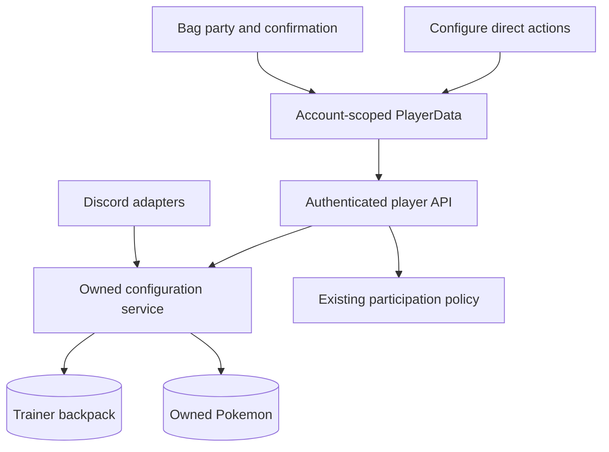

# Configure Pokemon nature and held items on the web

## Goal Capsule

- **Objective:** Players can change an owned Pokémon’s nature and give, swap or remove its held item from the web interface.
- **Means:** Extend the existing Pokémon upgrade workspace and Bag using one shared owned-configuration service (KTD1–KTD4).
- **Authority:** The maintainer’s approved study and subsequent comments govern the interaction; the maintainer’s latest instruction limits reliability work to the existing collection/training approach. This plan makes those decisions executable.
- **Execution profile:** Six dependent units, delivered in one feature PR above training PR #259. Reuse the current checkout and preserve its unrelated untracked Bag artifacts. Do not restack older PRs as part of this feature.
- **Completion ownership:** The implementer delivers the feature and local verification. Publishing and deployment require their own authorization; this planning request does not start production implementation.
- **Stop conditions:** Return for a product decision if implementation requires changing an approved interaction or exceeding KTD2’s reliability scope. Ordinary helper names and component splits remain implementation choices.

---

## Product Contract

### Summary

Add one **Configure** tab beside Train for the inspected Pokémon.
Held-item selection applies immediately; Remove is direct; nature selection previews stats and its Change nature button applies the change.
Bag opens an active-party picker followed by confirmation, including nature choice for a generic Mint.

### Problem Frame

The web already supports collection, party, Bag and training, but Mint and held-item actions still stop at unavailable-destination messages.
The Discord operations exist, although their backpack and Pokémon writes currently use separate legacy save paths.

### Key Decisions

- **Direct Configure actions.** The current screen already provides the choice and nature preview, so an additional review step adds no useful decision. Governs R2, R3. (session-settled: user-directed — chosen over Configure confirmation dialogs: the preview already supplies the review.)
- **Bag retains confirmation.** The party picker establishes the target before the player commits the item or Mint. Governs R4, R5. (session-settled: user-directed — chosen over immediate Bag execution: selecting a party member leads to confirmation.)
- **Compact consequence copy.** Quantity panels, the repeated nature-cost subtitle and the held-item return footer were removed after rendered review. Governs R5. (session-settled: user-directed — chosen over repeated consequence panels: cost belongs next to its action.)

### Requirements

**Workspace and Bag**

- R1. Configure is one implemented tab beside Train, retaining the selected Pokémon and invoking collection’s return context; no new main-navigation destination or Pokémon picker is added to the upgrade host.
- R2. Selecting an owned held item in Configure immediately gives/swaps it, and Remove immediately removes it, without a review dialog.
- R3. Selecting a nature in Configure only previews its six resulting stats; Change nature applies it directly for one Mint, with the cost and owned quantity visible beside the action.
- R4. Bag’s Mint/held-item action opens the active party in the configured formation; selecting an occupied slot loads that Pokémon and opens confirmation without navigating away from Bag.
- R5. Bag confirmation shows the selected Pokémon and nature preview or current/new held item; use `Owned: {number}` for item-quantity labels, keep Mint usage by the confirm actions, and omit separate quantity panels and the old-item-return footer.

**Rules and server authority**

- R6. Validate the authenticated owner and configured IDs on every mutation; current nature, already-held item and removing an empty held slot cause no resource change.
- R7. Support all 25 configured natures, including distinct neutral natures, using the canonical server stat calculator; held-item battle effects do not alter collection stats or an already-started battle snapshot.
- R8. A normal successful nature change debits one generic Mint; give debits one selected item; swap also returns the previous item; removal returns the previous item. There is no money fee.
- R9. Web reads, previews, opening and cancellation grant nothing; changed web operations use the corresponding mutation participation policy: nature 10 trainer EXP / 25 money, held item 5/10, without double grants.

**Lifetime and reliability**

- R10. Disable competing writes while a request is pending; stale/unknown outcomes require refresh and a new deliberate action, with no automatic mutation replay.
- R11. Reconcile the original account’s Pokémon, Bag, trainer, collection, party and training data after a submitted change settles, including departure; ignore obsolete-account results and never restart Train automatically.
- R12. Match the existing web reliability level: narrow conditional writes and bounded compensation for definitive failure, accepting the disclosed cross-document crash, ambiguity and legacy-writer gaps in KTD2.

### Flows and Acceptance Examples

- F1. Collection inspection → Train workspace → Configure → select held item or preview nature → direct mutation → updated current state. Back or Pokémon navigation returns to the invoking collection.
- F2. Bag item → active-party picker → selected Pokémon detail → confirmation → updated result → party or Bag. Back from confirmation, Close, outside dismissal and Escape before submission spend nothing.
- AE1. Given Pikachu holds Leftovers and the Bag has one Choice Band, selecting Choice Band in Configure updates its held item without a modal; the normal inventory result is Choice Band −1 and Leftovers +1. Covers R2, R8.
- AE2. Given three Mints, selecting Adamant changes only the preview; clicking Change nature changes current nature and leaves two Mints, without opening another dialog. Covers R3, R7, R8.
- AE3. Given Bag Mint → Gardevoir, selecting a nature and cancelling leaves its nature and Mint count unchanged; confirming applies the selected nature. Covers R4, R5, R9.
- AE4. Given a submitted change loses its response, the screen never resends it; refresh shows current authoritative state before another deliberate action. Refresh does not prove which request produced that state or repair every accepted partial-write gap. Covers R10, R12.

### Scope Boundaries

Included: shared ordinary nature/held-item operations and their Discord adapters, authenticated web transport, cache reconciliation, Configure, Bag targeting and focused acceptance.

Not built: transactions or a replica-set migration, durable journals/receipts, a new mutex/recovery framework, automatic mutation retries, global revision counters, or a general migration of legacy writers.
The maintainer explicitly chose the existing web reliability level over those additions; revisit only if actual operation failures justify a separate effort.

Deferred to follow-up work: equipment, evolution/forms, party editing from Bag, other Bag uses, and changes to Mew’s bespoke configuration flow.
No production deployment, real-account mutation or standing PR monitoring is included.

---

## Planning Contract

### Key Technical Decisions

- KTD1. **One shared owned operation module.** Add `src/services/pokemonConfiguration.js` beside `training.js`; reuse `findOwnedPokemon` and `calculatePokemonStats`, and keep formatting/participation grants in adapters. Move the existing held-item callers to this module before retiring their duplicated functions in `pokemon.js`, avoiding a circular import.
- KTD2. **Use the current narrow-write approach.** Apply the configured backpack delta in one non-upserting conditional trainer update, then a guarded Pokémon patch. Attempt one guarded inverse only after a definitive Pokémon rejection; an exception may have applied and is not proof that refund is safe. No operation marker or background recovery is added. (session-settled: user-directed — chosen over full crash recovery: go only as far as the other web interfaces and do not invent a new system.) Governs R12.
- KTD3. **Preserve the observed target, not a whole snapshot.** The write carries the expected current nature or held-item ID; the service rereads ownership and stock. Nature guards its observed stat inputs like training and patches nature/derived stats; held changes patch only `heldItemId`. A stale guard returns a conflict rather than silently changing a newer choice.
- KTD4. **Reuse authenticated player transport and account cache ownership.** Add configuration GET/POST routes to `playerApi.js` with the existing session/actor/origin/quota middleware. Add a configuration query and mutation to `PlayerData`, following training’s actor/epoch and departed-request cleanup rather than building another client data layer.
- KTD5. **Keep shared display content small.** Reuse the production identity/artwork/type controls and read-only `PartyView`; share the nature selector/stat preview between Configure and Bag. Configure owns direct controls, while Bag owns its confirmation state. Do not create an upgrade registry or bulk-save interface.
- KTD6. **Keep Bag result context when the last copy is used.** Retain the selected item’s display metadata in local feature state with authoritative quantity zero until the player leaves that detail. Do not add it to the owned-items list; a fresh load may discard an item URL that is no longer owned, as Bag does today.

### High-Level Technical Design



The browser reads a configuration projection containing owned detail, all nature choices with server-calculated preview stats, owned held-item choices and Mint quantity/cost.
Extend owned detail with a stable nature ID and type its already-returned `heldItemId`.
The write is a discriminated nature or held-item action, with selected ID/null and the expected current nature/held ID; it never accepts an owner, price, quantity or raw stat patch from the client.

| Contract | Planned shape |
| --- | --- |
| Read | `GET /api/player/pokemon/:id/configuration`; grantless configuration context. |
| Nature write | `POST` to the same path; `kind: nature`, selected `natureId`, `expectedNatureId`. |
| Held write | `POST` to the same path; `kind: heldItem`, selected `heldItemId` or null for removal, nullable `expectedHeldItemId`. |
| Context | Safe owned `pokemon`, `natures` with canonical preview stats, owned `heldItems`, `mintQuantity`, and cost 1. |
| Mutation result | Refreshed context, full safe Bag `items` projection, `changed`, trainer projection and optional saved-result warning, inside the existing actor envelope. |
| Failure | Existing 401/account-change/origin/429 conventions; 404 for non-owned targets, conflict for changed intent/state, and uncertainty for ambiguous/incomplete writes. |

```mermaid
sequenceDiagram
  participant S as Configuration service
  participant T as Trainer document
  participant P as Pokemon document
  S->>S: Validate and compute from fresh owned state
  S->>T: Conditional inventory delta, no upsert
  alt Delta definitively rejected
    T-->>S: No match; stop without Pokemon write
  else Delta confirmed
    S->>P: Narrow owner/current-build guarded patch
    alt Pokemon write confirmed
      P-->>S: Changed; adapters may grant participation
    else Pokemon definitively rejected
      S->>T: One inverse delta guarded by observed postvalues
      T-->>S: Compensation confirmed or unresolved
    else Pokemon write ambiguous
      S-->>S: Report uncertainty; no blind refund or replay
    end
  else Inventory write ambiguous
    S-->>S: Report uncertainty; no replay
  end
```

KTD2 does not make the two documents atomic.
Process death between writes, ambiguous results, changed inventory refusing compensation, a returned old item spent during overlap, and later stale legacy saves remain accepted limits.
The same limits apply to unrelated legacy inventory/equipment/crafting/trade writers; this feature does not migrate them.
MongoDB’s [single-document atomicity guidance](https://www.mongodb.com/docs/manual/core/write-operations-atomicity/) supports the scoped conditions, while [standalone transaction limits](https://www.mongodb.com/docs/manual/data-modeling/enforce-consistency/transactions/) explain why a transaction is not a drop-in change here.

```mermaid
stateDiagram-v2
  [*] --> Ready
  Ready --> Pending: Direct Configure action or Bag confirm
  Pending --> Ready: Confirmed result or definitive compensated rejection
  Pending --> NeedsRefresh: Conflict, uncertainty or incomplete compensation
  NeedsRefresh --> Ready: Read current state; do not replay
  Pending --> Departed: Leave feature
  Departed --> [*]: Settle and invalidate original-account reads
```



The write gate belongs to the account; feature selection, drafts and confirmation belong to their mounted feature.
Switching tabs unmounts Train and stops its scheduler; a submitted tick may still finish.
The existing mutation key/gate prevents starting a configuration write while it does, and prevents the reverse overlap within the web client.

### Assumptions and Existing Behavior

- Party membership limits Bag’s picker, not the ordinary owned-configuration service. Ownership is always revalidated; moving an already-selected Pokémon within/out of the party does not retarget the request.
- Preserve the existing inspection Train entry. Upgrade tab changes replace that upgrade history entry, so Back still returns to the invoking collection rather than stepping through tabs.
- Web mutation rewards follow the actual Discord mutation, not rewards for opening the Discord command. Keep Discord’s existing command-opening/UI interaction policy unchanged.
- `runbook.md` documents standalone MongoDB; no production topology inspection or change is needed for this plan.
- Exact helper names, error-code spelling and a small component split may be refined during implementation. They must preserve R1–R12 and the existing player HTTP conventions.

### Sources and Existing Patterns

- `docs/design/nature-held-items/README.md`: approved interaction, final copy and study-only evidence; this plan is the canonical implementation specification.
- **Machine-local prototype, best effort:** `/Users/elviswei/.codex/worktrees/d66b/pokestar/.context/compound-engineering/ce-prototype/2026-11-08-nature-held-items/`. Read `decisions.md` and `01-configure-and-bag/screens/{index.html,study.js,study.css}` for Configure, Bag held-item and Bag Mint states. A missing prototype is not a blocker; this plan governs any disagreement.
- `docs/design/owned-collection/architecture.md`, approved amendment; `src/services/training.js`, guarded training in `src/services/pokemon.js`, `src/services/party.js`, and `src/services/battleAuto.js`: existing ownership, conditional-write and non-replay patterns.
- `src/events/natureConfirm.js`, `src/elements/pokemon/ChangeHeldItem.js`, `src/config/eventConfig.js`, `src/handlers/eventHandler.js`: canonical old adapters and participation policies.
- `web/src/player/PlayerData.ts`, `web/src/player/CollectionFeature.tsx`, `web/src/bag/BagFeature.tsx`, `web/src/collection/PartyView.tsx`, `web/src/navigation/routes.ts`: current cache, return-context and picker seams.
- Tickets [#205](https://github.com/ewei068/pokestar/issues/205) J24 only, [#208](https://github.com/ewei068/pokestar/issues/208), [#250](https://github.com/ewei068/pokestar/issues/250), [#251](https://github.com/ewei068/pokestar/issues/251). The maintainer’s approved Bag flow and R12 supersede conflicting navigation or stronger atomicity language in those tickets.

---

## Implementation Units

### U1. Shared owned configuration rules and narrow persistence

**Goal:** Provide one authoritative context and mutation path for ordinary nature and held-item changes.

**Requirements:** R6–R8, R10, R12; KTD1–KTD3. Dependencies: none.

**Files:** Create `src/services/pokemonConfiguration.js` and `src/services/__tests__/pokemonConfiguration.test.js`; use `src/services/pokemon.js`, `src/config/pokemonConfig.js`, `src/config/backpackConfig.js` and the existing database helpers as dependencies.

**Approach:**

1. Read fresh trainer/owned Pokémon and expose canonical choices and all prospective nature stats without saving them.
2. Validate expected current IDs, configured category/stock and no-ops before writes; derive dotted inventory paths from trusted config.
3. Implement KTD2’s single inventory delta, guarded Pokémon patch and one definitive-failure compensation. Guard touched inventory values, treating absent paths explicitly; always disable upsert.
4. Guard nature’s observed EXP/level/EV/species/nature/IV/equipment inputs like training. Preserve unrelated name, held item, owner, party, money and backpack paths; held writes do not recalculate stored stats.
5. Distinguish no-op, changed, known conflict/rejection and uncertain/incomplete outcome using the existing typed-error/result style. Never retry a submitted resource delta.

**Patterns to follow:** `training.js`; guarded `addPokemonExpAndEVs`; party command conditions; `battleAuto.js` conditional debit. Keep these feature-local operations rather than extracting a general transaction helper.

**Execution note:** Establish behavior coverage before replacing legacy adapters; stateful mocks should model matched/no-match/throw outcomes rather than unconditional successful writes.

**Test scenarios:**

- All 25 nature choices use canonical stats, including equipped builds; distinct neutral IDs cost one Mint, while current nature costs none.
- Give/swap/remove produce R8’s normal deltas; same held item/empty remove are no-ops, including no spare copy of the currently held item.
- Wrong owner, malformed IDs, non-held categories, unknown choices, missing stock and stale expected IDs write nothing.
- Competing observed last-item debits cannot both match that same balance; a nature/training interleaving cannot overwrite a guarded newer build.
- A confirmed resource delta followed by definitive Pokémon rejection attempts exactly one postvalue-guarded inverse; refusal/exception is reported as unresolved, without overwriting intervening inventory.
- Ambiguous resource/Pokémon writes are not replayed or blindly refunded; unrelated fields survive every narrow patch.

**Verification:** Focused service tests establish participating-write behavior, not crash atomicity. U6 supplies real Mongo evidence and records accepted gaps.

### U2. Route the Discord adapters through the shared operation

**Goal:** Preserve ordinary Discord interactions while removing their duplicate configuration save paths.

**Requirements:** R6–R9, R12; KTD1–KTD3. Dependencies: U1.

**Files:** Modify `src/events/natureConfirm.js`, the nature-preview/state path in `src/services/pokemon.js`, and `src/elements/pokemon/ChangeHeldItem.js`; retire the old `changeHeldItem`/`removeHeldItem` implementation/exports after verifying callers. Add `src/events/__tests__/natureConfirm.test.js` and `src/elements/pokemon/__tests__/ChangeHeldItem.test.js`.

**Approach:**

1. Preserve nature state expiry/originating-user checks and bind its original nature for expected-state validation; call the shared service instead of debiting and saving snapshots locally.
2. Move held-item callbacks to the shared service, passing the held item observed by that UI. Check failure results before accessing trainer/Pokémon data; refresh both on rejection/uncertainty.
3. Keep the shared service grantless and preserve existing Discord handler policies. Nature top-level failures retain the handler’s existing non-grant behavior; held-item callbacks retain existing Deact participation behavior, including legacy grants on rendered failures and navigation. Web changed/no-op grant gating is independent (U3). Do not change the generic Deact callback protocol for this feature.

**Patterns to follow:** Existing nature copy and Deact callback rendering. Read the repository Deact skill before changing its element.

**Test scenarios:**

- Expired/foreign nature state writes nothing; valid confirmation invokes one shared change and preserves the current success presentation.
- Held selection/removal retain immediate Discord behavior; a rejected operation renders recovery instead of throwing during result destructuring.
- Nature top-level failures retain the handler’s existing non-grant path; held-item success, rendered failure and navigation retain existing Deact participation behavior. The shared service grants nothing.

**Verification:** Adapter mocks cover result handling and grant routing; they do not establish a live Discord click or real session acceptance.

### U3. Authenticated configuration transport and account-scoped reconciliation

**Goal:** Give both browser flows the same safe projection, mutation and cache ownership.

**Requirements:** R6–R12; KTD3, KTD4. Dependencies: U1.

**Files:** Modify `src/services/player.js`, `src/web/playerApi.js`, `web/src/player/types.ts`, `web/src/player/PlayerData.ts`, `src/services/__tests__/player.test.js`, `src/web/__tests__/playerApi.test.js` and `web/src/player/PlayerData.test.ts`.

**Approach:**

1. Add pure configuration GET and mutation POST under the selected owned Pokémon, following the training route pattern. Use read/action quotas respectively; require session and actor assertion, plus site origin on POST.
2. Validate exact body shape and expected current ID; return only safe projections. Add stable nature ID and typed held-item ID to owned detail, preserving existing fields/callers.
3. Apply R9’s best-effort participation policy only after a changed operation. Reuse training’s saved-result warning handling when later grant/projection work fails; never relabel the change as safely unsubmitted.
4. Add one account-scoped configuration query and mutation using the existing interaction key/write gate. Cancel affected reads before submission and on settlement; install valid result projections and invalidate Bag, detail, configuration, training, collection, party and trainer as appropriate.
5. Preserve the training departure fix: when a submitted request settles after unmount or feature change, cancel/invalidate the original account’s affected reads even if the departed UI ignores its result. Keep account/epoch guards and mutation retry disabled.

**Patterns to follow:** `PlayerData.train`, `refreshTraining`, `playerApi` middleware and `player.train` grant/warning handling.

**Test scenarios:**

- GET is grantless; POST rejects unauthenticated/wrong-actor/origin/unknown-field/invalid-choice requests; action quota returns the existing 429 behavior.
- Changed nature grants 10/25, held grants 5/10, no-ops/rejections grant nothing; a later grant/projection failure never submits another inventory operation.
- A stale GET that started before mutation cannot overwrite settled Bag/detail/preview data; a departed submitted request invalidates queries after it finishes.
- Sign-out/account switch cannot install or invalidate data in a newer account; refresh performs reads without replaying writes.
- Nature updates CP/sort/party summaries and invalidates training context; held changes update held detail and Bag without fabricating collection-stat multipliers.

**Verification:** Stateful service/HTTP/cache tests cover the seams separately; U6 exercises the real request/store path. Run client tests/build because the shared detail contract changes.

### U4. Configure tab in the existing upgrade workspace

**Goal:** Implement the approved direct Configure interaction without disturbing Train or collection return context.

**Requirements:** R1–R3, R5, R7, R10, R11; AE1, AE2. Dependencies: U3.

**Files:** Modify `web/src/upgrades/PokemonUpgradeWorkspace.tsx`, `web/src/player/CollectionFeature.tsx`, `web/src/navigation/routes.ts`, their existing tests, and `web/src/upgrades/TrainingFeature.tsx` as needed for the shared pending gate. Create `web/src/upgrades/ConfigureFeature.tsx`, `ConfigurePanel.tsx`, a shared nature-preview/editor component, scoped CSS, and `ConfigureFeature.test.ts` / `ConfigurePanel.test.ts` beside them.

**Approach:**

1. Extend the upgrade route to Train/Configure, preserving existing Train links, root/subpath handling and unrelated URL parameters. Replace history on tab changes and preserve the invoking-entry return state.
2. Render only the active feature; tab departure disposes Train’s scheduler. Use the existing account mutation state to disable new Train/Configure writes until an already-submitted request settles.
3. Build the approved identity and two Configure sections using shared appearance. Item selection immediately mutates; Remove is direct. Nature selection is a draft preview; Change nature submits it without a dialog.
4. Keep loading, missing owner, unavailable stock, pending, stale and unknown states inline. Use authoritative current values after settlement, and preserve drafts/focus during ordinary reads where still valid.

**Patterns to follow:** The approved local study, production `ui.css`, `CollectionArtwork`, type badges and `TrainingFeature` lifetime boundaries.

**Test scenarios:**

- Covers AE1 and AE2: selection/action triggers exactly the intended mutation, with no extra confirmation and no spend on nature preview alone.
- Current nature, already-held item, empty removal and missing Mint/item remain no-ops; all quantity labels use R5.
- Pending blocks competing actions; rejected/unknown outcomes refresh without retry. Long labels, absent artwork and all six stat rows remain usable on phones.
- Train → Configure during a pending tick prevents a competing write; returning to Train never resumes it automatically.
- Tabs/history and Back/Pokémon navigation preserve the invoking collection’s search, selection, panel scroll and focus for root and subpath URLs.

**Verification:** Component/feature tests prove triggers and lifetime; production-browser comparison at U6 proves layout and actual navigation.

### U5. Bag party picker and confirmation

**Goal:** Replace Mint/held-item unavailable messages with the approved party-first flow while retaining Bag context.

**Requirements:** R4, R5, R8–R11; AE3, AE4; KTD5, KTD6. Dependencies: U3, U4’s shared display content.

**Files:** Modify `web/src/bag/BagFeature.tsx`, `itemUse.ts`, Bag CSS and their existing tests; create `BagPokemonUse.tsx` / `BagPokemonUse.test.ts` in that directory. Reuse `web/src/collection/PartyView.tsx`, adding only a small read-only selection affordance if needed, with focused coverage.

**Approach:**

1. Keep category, selected item, URL and underlying Bag mounted while a single modal flow moves between party selection, target loading and confirmation. Other item-use actions retain their current behavior.
2. Read the active party once through PlayerData; preserve rows/columns/slot identity and disable empty positions. Load configuration for the chosen target, not separate detail reads for every party member.
3. Use the shared nature preview for Mint or current/new held-item facts for equip/swap. Keep R5’s cost/copy choices, with no extra quantity panel or old-item-return footer.
4. Handle empty party, failed target read, lost ownership, exhausted stock, current-choice no-op, pending and unknown result. Back returns to party; Close/outside/Escape before submission returns to the invoking item action.
5. Preserve KTD6’s zero-owned result detail when the last copy disappears from the owned Bag projection. Restore focus to its heading if Use is disabled; clear the temporary snapshot when leaving that item/result.

**Test scenarios:**

- Covers AE3: both item types reach confirmation only after party selection; Back/Close/Escape before submission spend nothing and preserve Bag filters/selection.
- Arbitrary projected formation dimensions and empty slots render read-only selection with correct IDs; no drag/manage action is exposed.
- Missing target details, wrong owner and exhausted stock cannot confirm; current-choice no-op remains ungranted.
- Confirmed give/swap/nature updates current quantities and selected Pokémon; last-copy use retains zero-owned detail without adding a zero-stock owned-list row.
- Covers AE4: unknown result blocks further writes even after closing the modal; a refresh/reopen cannot automatically replay or bypass the account gate.

**Verification:** Feature tests cover state transitions and focus fallback; U6 checks the actual overlay at desktop, phone and short-phone widths.

### U6. Integrated acceptance and maintained evidence

**Goal:** Establish the working cross-surface contract and record exactly what was verified.

**Requirements:** R1–R12; AE1–AE4. Dependencies: U1–U5, including the Discord migration.

**Files:** Update `docs/efforts/web-battler.md`, `docs/design/nature-held-items/README.md`, `web/README.md` where endpoint/setup guidance warrants it, and create `docs/verification/nature-held-items-2026-11-08.md` using the actual acceptance date if later.

**Approach:** Exercise the complete implementation against disposable Mongo and production client bundles, preserving the approved runtime boundaries and current diagnostic baseline.
Do not load production credentials/databases, deploy, or use real-account resources for acceptance.

**Test scenarios:**

- Real HTTP/Mongo normal nature/give/swap/remove, no-op, owner/origin validation, shortages, guarded conflicts and definitive compensation; reread persisted Pokémon and exact inventory deltas after reload.
- Controlled write interruption demonstrates the declared no-replay/uncertainty behavior. Document crash/legacy-writer exposure under R12 rather than asserting transaction or restart recovery.
- Production browser at 1280, 831, 390 and 320 px, including 320×480 confirmation scrolling; exercise Train departure, collection return, both Bag flows, last-copy use, unknown response and account/session loss.
- Root and `/pokestar/` builds preserve configuration routing and Bag assets; live Discord/OAuth or physical-device checks are claimed only if actually performed.

**Verification:** Maintain a concise evidence record separating mocked tests, real local persistence/browser observations, accepted reliability gaps and checks not performed.
No extra unit tests are needed for the documentation itself.

---

## Verification Contract

| Check | Applies to | Completion signal |
| --- | --- | --- |
| Focused Jest suites, then `npm test -- --runInBand` | U1–U3 and shared backend behavior | New behavior and full backend suites pass; mocks are not called crash/concurrency proof. |
| `npm run typecheck` | Backend changes and callers | Compare normalized diagnostics with the implementation baseline; report remaining failures. Previous checkpoint had 498 diagnostics. |
| `npm run lint -- <changed backend files>` | U1–U3 | No introduced lint errors; preserve/report existing warnings. |
| `npm test --prefix web` | U3–U5 | Client triggers, account lifetime, no-replay and departure regressions pass without forced exit. |
| `npm run build --prefix web`, also with `WEB_BASE_PATH=/pokestar/` | U3–U5 | TypeScript and both production bundles pass; URLs/assets work at both base paths. |
| Disposable real Mongo/HTTP and production browser | U6 | Persisted normal deltas, guards/known compensation and actual entry/return flows have observed evidence. |

Use the documented Node 24 runtime for verification.
Do not restore React DOM assertions that format cyclic DOM on transient failure or hide QueryClient leaks with forced test exit.
Reuse established training evidence for unchanged behavior, and rerun affected lifecycle checks because a second real upgrade tab now exists.

---

## Definition of Done

- Configure and both Bag flows satisfy R1–R12 and the maintainer’s final copy refinements.
- Ordinary Discord/web configuration uses one owned service; error/no-op handling and participation policies are covered.
- Normal inventory/build results persist after reload; known conflicts use narrow compensation and unknown outcomes are not replayed.
- Existing collection/Train behavior, account isolation, departure reconciliation and root/subpath routing remain intact.
- Verification records passing checks, the actual typecheck baseline, and accepted cross-document/legacy limitations without claiming stronger guarantees.
- The approved UI and implementation evidence are discoverable from the effort document; unrelated untracked Bag work remains untouched.
