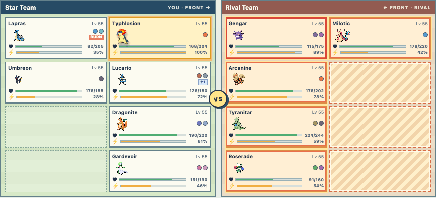

# Fire Special particle study

Question: can a generated source texture and a small code-driven particle renderer
produce a better tile effect than the current moving SVG silhouette?

This is a throwaway development story, not a production effect. Open the existing
VFX lab with `?previewBattle=1&story=vfx&type=fire&kind=special&pattern=all&variant=column`
while running `cd web && npm run dev`. Use the floating arrows or left/right keys
to compare the current SVG with three particle behaviors:

The selected direction is **Rising column** with one dominant, long-lived
tailed ember at its center. Smaller flame shapes and embers rise around it.
The small embers are now drawn over the main ember, beginning near its bright
core and drifting through the foreground.
The other variants remain for comparison:

| Variant | Still at about 650 ms |
| --- | --- |
| Current SVG |  |
| Flame bloom |  |
| Rising column |  |
| Ember burst |  |

The canvas spans the existing battle board, draws at every executed tile (including
empty tiles), and shares the move's 1.5-second playback interval. The three new
variants use the generated transparent flame source at
`media/vfx/experiments/fire-special-flame-source.png` and three small generated
ember sprites (`fire-ember-coal.png`, `fire-ember-fleck.png`, and
`fire-ember-fork.png`). The bloom and selected column each have one larger
tailed ember with a bright core at its base that lasts for the whole effect.
The column gives that ember more scale and reduces the supporting flames.
Smaller embers have individually
seeded birth times, lifetimes, directions, sizes, rotations, and sprite
selections. Each tile's seed comes from its team and position, so tiles vary even
within the same action and replaying the story keeps each tile's appearance.
For production, combine this tile key with the battle event's stable identity.
The effect is excluded from production builds.

The mobile layout was also checked with the column variant:

The direction is ready to be rewritten as the production Fire Special renderer.
Keep this study for comparison until real event playback has been reviewed.
The shared workflow is in the [battle VFX creation guide](../../battle-vfx-guide.md).

Before production, the move actor and tile effects need one playback clock. The
prototype currently aligns a canvas timeline to a CSS actor animation by fixed
offset, which can drift if either timing changes. The source flame is also a large
generated bitmap scaled into small tiles; authoring at the target pixel scale or
building a compact atlas would provide sharper, more consistent art. Check the
effect on lower-powered phones when more targets or overlapping effects are added.

Pokémon Showdown is a useful choreography reference: its [animation
renderer](https://github.com/smogon/pokemon-showdown-client/blob/master/play.pokemonshowdown.com/src/battle-animations.ts)
places and animates image effects at timed positions. A `fireball` is defined as
a 64×64 image, while the [Flamethrower move
animation](https://github.com/smogon/pokemon-showdown-client/blob/master/play.pokemonshowdown.com/src/battle-animations-moves.ts)
launches several copies at staggered times and slightly different endpoints.
The move table also maps other moves, including Ember, onto that choreography.
Its [client license](https://github.com/smogon/pokemon-showdown-client#license)
is AGPLv3, so this study uses independently generated art and code.
