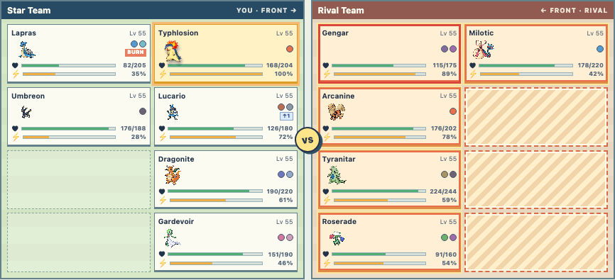
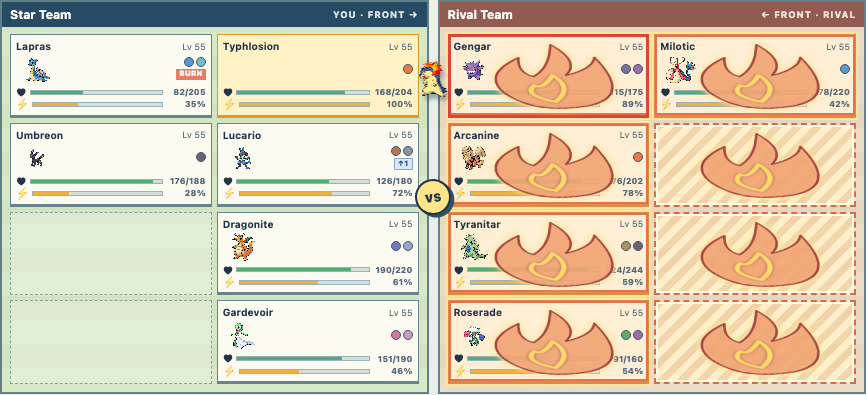
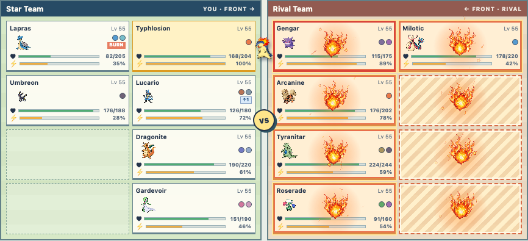
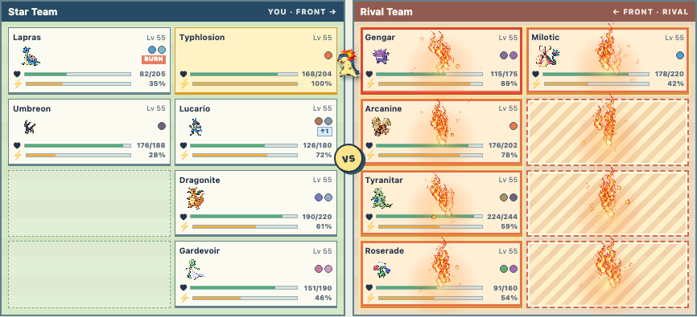
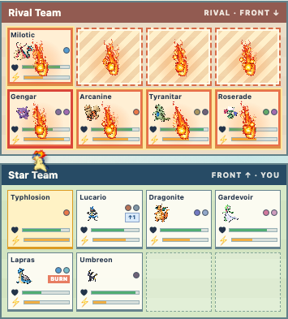

# Fire Special particle study

Question: can a generated source texture and a small code-driven particle renderer
produce a better tile effect than the current moving SVG silhouette?

This is a throwaway development story, not a production effect. Open the existing
VFX lab with `?previewBattle=1&story=vfx&type=fire&kind=special&pattern=all&variant=bloom`
while running `cd web && npm run dev`. Use the floating arrows or left/right keys
to compare the current SVG with three particle behaviors:

| Variant | Still at about 650 ms |
| --- | --- |
| Current SVG |  |
| Flame bloom |  |
| Rising column |  |
| Ember burst |  |

The canvas spans the existing battle board, draws at every executed tile (including
empty tiles), and shares the move's 1.5-second playback interval. The three new
variants use the generated transparent flame source at
`media/vfx/experiments/fire-special-flame-source.png` and three small generated
ember sprites (`fire-ember-coal.png`, `fire-ember-fleck.png`, and
`fire-ember-fork.png`). The bloom has one larger central coal that lasts for the
whole effect, while smaller embers have individually seeded birth times,
lifetimes, directions, sizes, rotations, and sprite selections. The seed keeps
replays visually consistent. The effect is excluded from production builds.

The mobile layout was also checked with the column variant:

The next decision is which behavior and visual scale to keep, or whether a baked
sprite sheet is preferable. Once chosen, rewrite that behavior as the production
Fire Special renderer and remove the prototype switcher and unused variants.

Before production, the move actor and tile effects need one playback clock. The
prototype currently aligns a canvas timeline to a CSS actor animation by fixed
offset, which can drift if either timing changes. The source flame is also a large
generated bitmap scaled into small tiles; authoring at the target pixel scale or
building a compact atlas would provide sharper, more consistent art. Check the
effect on lower-powered phones when more targets or overlapping effects are added.

Pokémon Showdown is a useful choreography reference: its [animation
renderer](https://github.com/smogon/pokemon-showdown-client/blob/master/play.pokemonshowdown.com/src/battle-animations.ts)
places image effects at timed positions, and its [move animation
table](https://github.com/smogon/pokemon-showdown-client/blob/master/play.pokemonshowdown.com/src/battle-animations-moves.ts)
reuses behaviors across moves. Its [client license](https://github.com/smogon/pokemon-showdown-client#license)
is AGPLv3, so this study uses independently generated art and code.
