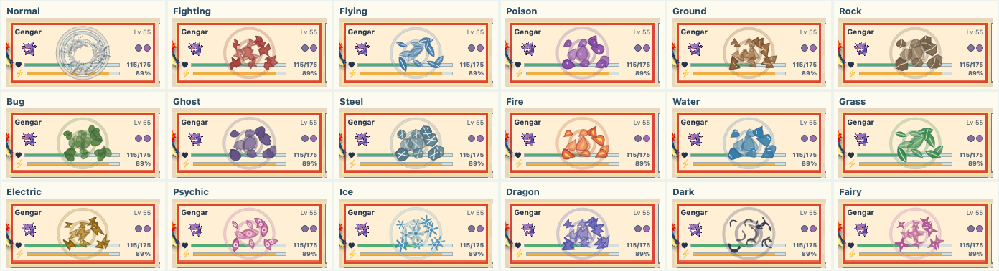
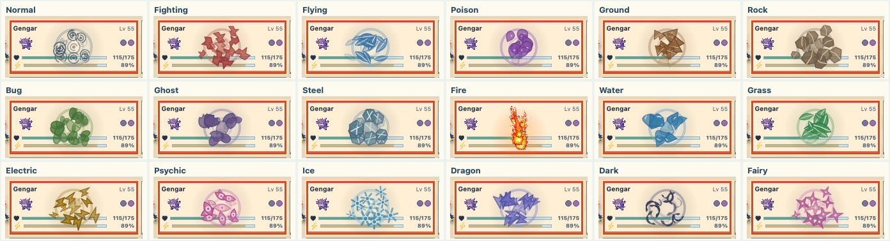
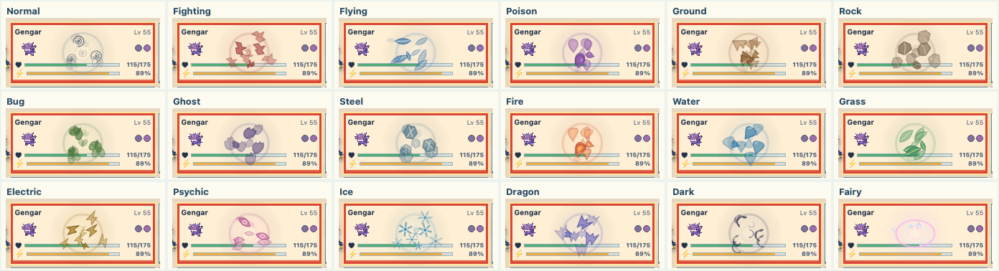

# Full tile VFX matrix: first pass

This development-only study gives every standard move type a Physical, Special,
and Status tile effect. The 18 × 3 matrix is available in the existing VFX lab:

`?previewBattle=1&story=vfx&type=water&kind=special&pattern=all&variant=study`

Change **Type**, **Action**, and **Area** in the toolbar. The floating control
compares the new effect with the current SVG. Normal Physical and Fairy Status
use their approved focused studies; Fire Special uses its rising-column study,
which now has a smaller center ember and lower ember origins. Unknown, Shadow,
and Stellar use Normal as the visual fallback. No live battle rendering changed.

The [second-pass Poison, Fighting, and Fire changes](second-pass.md) follow the
[October 12 review notes](review-2026-10-12.json). Compare those seven in the
[temporary animated grid](../../../web/vfx-review.html); the contact sheets
below record the original breadth pass and have not been regenerated.

## Contact sheets

Each image shows one affected tile at about 700 ms into playback, at its
actual desktop board size. These are review aids, not sprite sheets.

| Category | All 18 types |
| --- | --- |
| Physical |  |
| Special |  |
| Status |  |

Motion and full footprints matter more than a still. Representative loops:

- [Water Physical](water-physical-motion.gif): short impact bursts and outward drops.
- [Electric Special](electric-special-motion.gif): sustained field and moving bolts.
- [Ghost Status](ghost-status-motion.gif): softer halo with staggered wisps.

## How this pass was made

The 51 combinations outside the focused studies use a clean silhouette for
each type, drawn directly in canvas with the existing type palette. Physical
uses two compact pulses and outward fragments. Special uses a sustained field,
expanding rings, and more motes. Status uses a weaker halo and staggered motes.
Type-specific paths make leaves, drops, bolts, shards, wisps, and other
silhouettes travel differently. Timing, size, angle, and position vary by tile
seed, so the same action does not stamp identical frames across its footprint.

This is a breadth pass, not 51 finished art approvals. The small code-drawn
shapes are useful for testing choreography and identifying which cells need
generated or hand-authored texture. Some may still read too much like icons or
share too much timing; those are the main questions for review. The approved
Normal Physical and Fairy Status studies should remain the quality baseline.

Browser capture covered all 54 standard combinations without page errors.
Six representative combinations were also checked across eight-tile patterns
at 375px and 320px, with no board overflow. Reduced motion hides the study
canvas. Production promotion still needs the shared actor/VFX playback clock
described in the [VFX creation guide](../../battle-vfx-guide.md).
