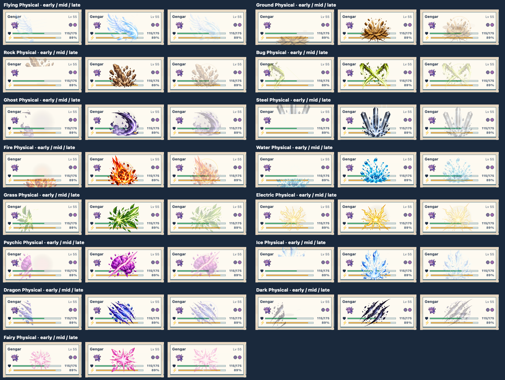
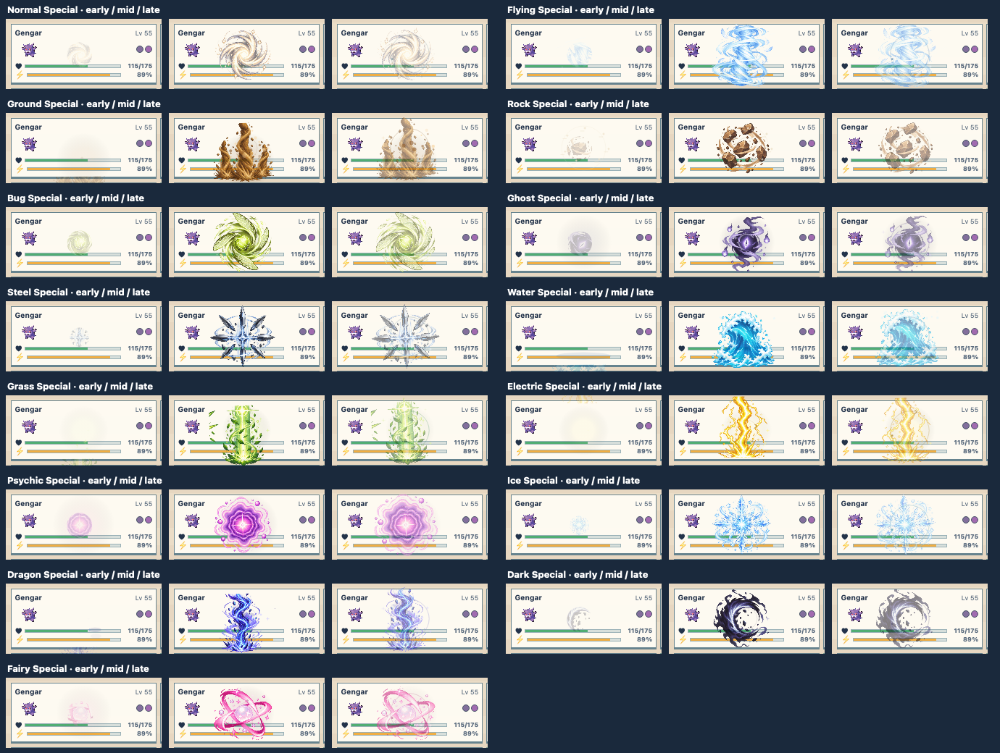
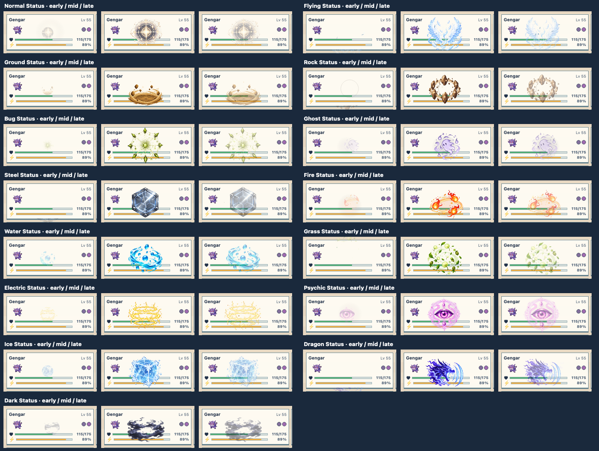

# Full matrix art candidates for review

The [animated review grid](../../../web/vfx-review.html) shows 54 type/category
effects. This pass adds new generated focal art to 45 cells, with a distinct
Physical, Special, and Status subject for each of 16 types. Poison and
Fighting's six focused effects remain, as do the approved Normal Physical,
Fire Special, and Fairy Status studies. The grid's **45 new art candidates**
filter isolates the changes and shows earlier notes beneath each revised card.

The source art is in [review-atlas](../../../media/vfx/review-atlas/README.md).
Each tile reveals its subject over time, then disperses it, with type-specific
material accents and seed-based per-tile variation. The earlier procedural
renderer remains selectable in the VFX lab for comparison. The new art is
review-only: live battle playback still uses its current SVG effects.

| Category | Early / peak / release at board size |
| --- | --- |
| Physical |  |
| Special |  |
| Status |  |

The stills help identify clipping, scale, and timing issues. Judge the full
loops and eight-tile patterns in the gallery and linked stories before
marking cells ready to promote. Source atlases are intentionally preserved at
generation resolution; production export and bundle optimization belong to
the later integration step.
