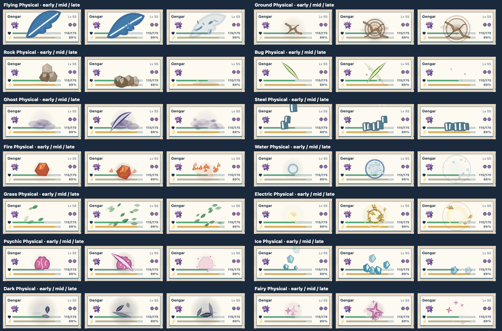
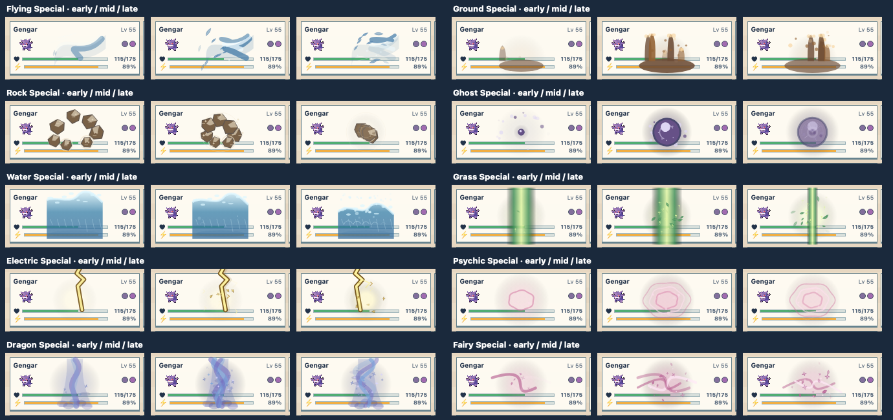
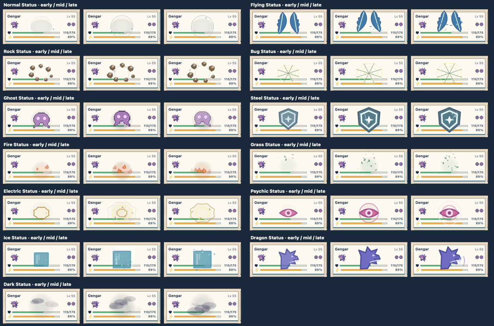

# Matrix tile VFX polish pass

The [review grid](../../../web/vfx-review.html) now shows a further pass on all
37 effects introduced in the [quality pass](quality-pass.md): 14 Physical, 10
Special, and 13 Status. Each retains the recognizable subject and timing from
that pass. The additions follow its material: feather flecks around a wing
strike, dust and chips around stone, foam and droplets around water, glints on
steel and ice, fine pollen around spores, and short arcs around electric
fields. Supporting marks have staggered lifetimes and use the tile seed, so
affected tiles differ while replaying the same event is deterministic.

The canvas renderer now draws atmosphere, the subject, then foreground marks.
This preserves the subject at tile scale and lets embers, chips, glints, and
similar details pass over it. It also keeps the approved focused Normal
Physical, Fairy Status, and Fire Special studies and the other earlier effects
unchanged. The gallery resets review marks only for these 37 revisions and
shows earlier notes beneath them.

| Category | Early, midpoint, and late frames |
| --- | --- |
| Physical |  |
| Special |  |
| Status |  |

These are development candidates. The contact sheets show one occupied tile
at actual desktop size; use the gallery's live previews and linked full-board
stories to judge movement and multiple affected tiles. Their strokes and
particles are code-authored, so future feedback can change timing and shape
without replacing a generated image. Production playback, result effects,
and sound are separate follow-ups.
