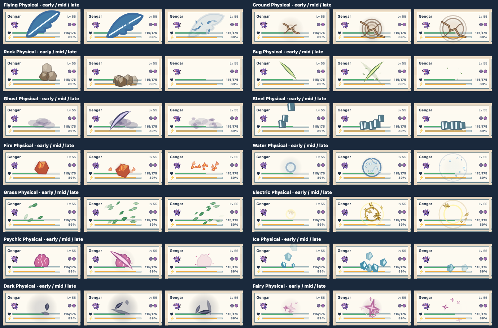
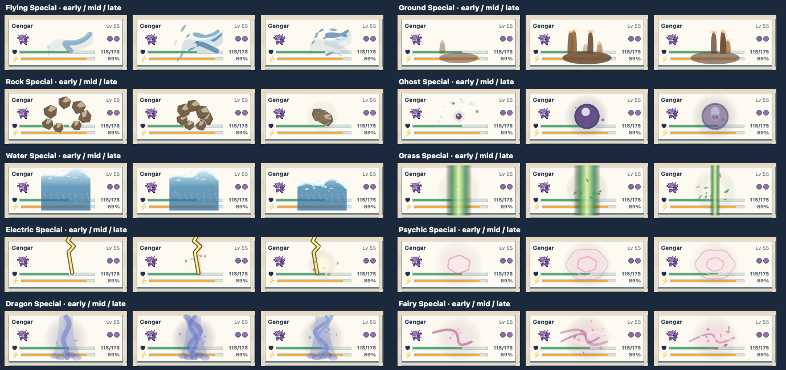
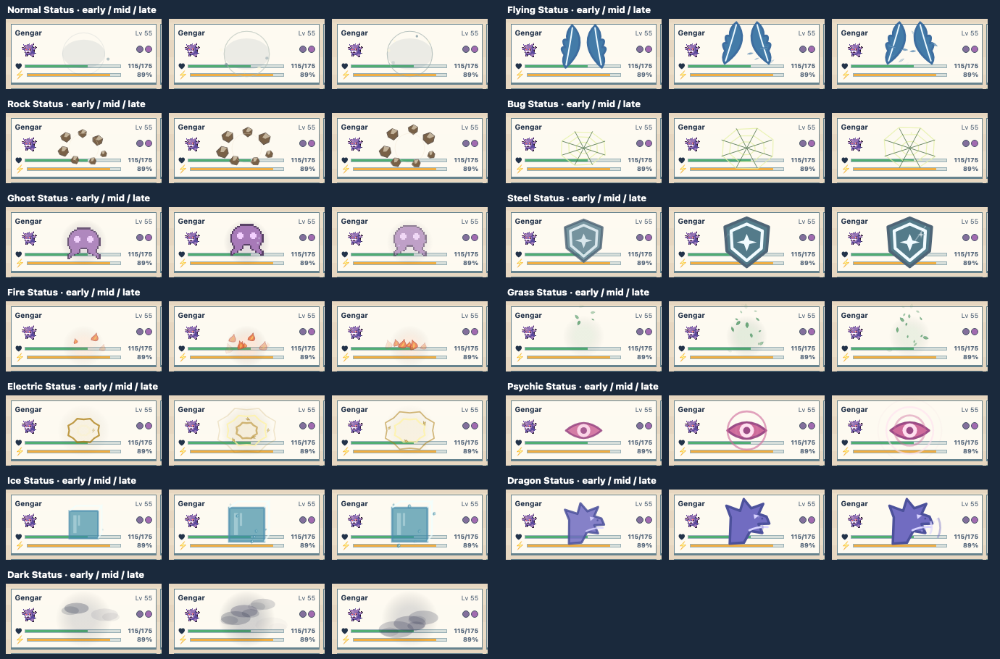

# Tile VFX quality pass across the remaining matrix

The [third review export](review-2026-10-12-round-3.json) gave specific new
directions for 37 combinations outside the focused Fighting and Poison studies.
This pass replaces those 37 first-pass treatments: 14 Physical, 10 Special,
and 13 Status. The other 17 combinations retain their existing study or
approved first-pass treatment. All work remains **development-only**; live
battle playback does not use these renderers yet.

The [live review grid](../../../web/vfx-review.html) animates all 54 cells.
Its “37 new candidates” filter isolates this pass, resets only their review
marks, and displays the prior notes alongside each changed cell.

| Category | Review direction implemented |
| --- | --- |
| Physical | Flying wing slam and feathers; Ground branching crack and pressure; Rock falling and breaking stones; Bug crossing sharp cuts; Ghost haze split by a slash; Steel heavy falling beams; Fire molten rock and embers; Water impact ring and bubbles; Grass directional leaves; Electric impact bolts and rings; Psychic brain and slash; Ice falling shards; Dark varied cuts; Fairy central star contact and sharp fragments. |
| Special | Flying broad gust and feathers; Ground rising mud; Rock orbiting stones converging to impact; Ghost motes feeding an expanding orb and burst; Water rising front-facing wave with foam; Grass vertical solar beam and orbiting leaves; Electric repeated falling bolts; Psychic wavy concentric fields; Dragon storm funnel with blue streaks; Fairy curved magic ribbons and motes. |
| Status | Normal soft ward distinct from its arcane Special; Flying rising paired wings; Rock floating stones; Bug stretchy web; Ghost original pixel ghost that fades and bobs; Steel shield and passing shine; Fire lateral embers near the ground; Grass falling spores; Electric jagged concentric shocks; Psychic eye and pressure rings; Ice enclosing cube; Dragon rearing head and roar waves; Dark horizontally moving fog layers. |

The ghost is an original project-owned pixel silhouette. No matching Lavender
Town sprite was found in the repository, and no game sprite was copied.
Shared drawing primitives and motifs live in `matrixVfxKit.ts`; category
sequences are in `matrixPhysicalVfx.ts`, `matrixSpecialVfx.ts`, and
`matrixStatusVfx.ts`. Approved cells keep their previous renderer.

## Motion review

Each sheet shows early, midpoint, and late frames at the review tile's actual
size. These are timing checks, not substitutes for judging a live loop.

| Category | 37 revised combinations |
| --- | --- |
| Physical |  |
| Special |  |
| Status |  |

The reviewed board tiles include occupied cards and empty cells through the
VFX lab's single and multi-tile patterns. The new shapes are code-authored
visual candidates, not final art approvals. Some complex subjects may still
benefit from dedicated small sprite sheets after the next visual review.
Sound, result effects, and production event playback remain separate work.
