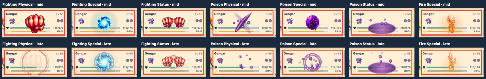

# Poison and Fighting VFX second pass

The [October 12 review export](review-2026-10-12.json) marked 10 combinations
approved, 43 needing work, and Fairy Status unreviewed in that export (it was
approved in an earlier conversation). The seven effects below changed after
that review. They are **new candidates**, awaiting a fresh judgment in the
[temporary live review grid](../../../web/vfx-review.html).

| Combination | Brief from review | New tile sequence |
| --- | --- | --- |
| Fighting Physical | One large punch and pressure rings | A fist enters from the actor, strikes once, then three rings expand. |
| Fighting Special | Directional sphere like an aura attack | A cyan sphere arrives from the actor, grows on impact, then sheds sparks and rings. |
| Fighting Status | Two fists make a block posture | Opposing fists converge, hold a guard pose, then a compact braced field appears. |
| Poison Physical | Crossed cuts and poison bubbles | Two staggered purple slashes cross; bubbles scatter outward. |
| Poison Special | Sludge bomb impact and drips | A toxic orb arrives from the actor, bursts into bubbles, rings, and falling drops. |
| Poison Status | Toxic circle on the ground | A wide puddle spreads below the target while bubbles rise. |
| Fire Special | Smaller center flame; embers start at bottom | The rising column keeps its focal ember but reduces it and launches foreground embers from lower on the tile. |

The fist, aura sphere, and poison orb are original generated transparent sprites
stored in `media/vfx/experiments/`. Their prompts requested isolated pixel art
focal elements with a transparent background; the generated outputs were
downscaled to 256 pixels for this study. Canvas code draws rings, slashes,
glows, bubbles, drips, and seeded variation around them.

The Poison and Fighting renderer accepts the attacker's position as an optional
origin. The development battle view measures its active actor and uses that
point to direct incoming fist and orb motion toward each affected tile. The
review grid uses a fixed actor position at the left. Each tile still runs its
own stable seed, and the renderer uses the same 760 ms VFX window as the prior
matrix.

Before promoting any candidate to live battle playback, review the full
animation on occupied and empty tiles, single and multi-tile patterns, desktop
and narrow screens. The development prototypes still use their own canvas
clock; production needs the shared actor/VFX playback clock specified in the
[creation guide](../../battle-vfx-guide.md).
