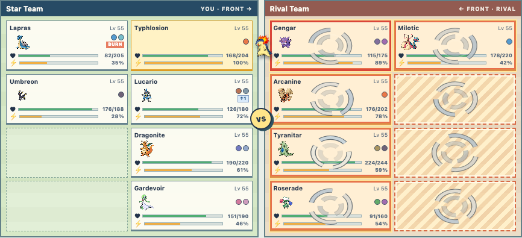
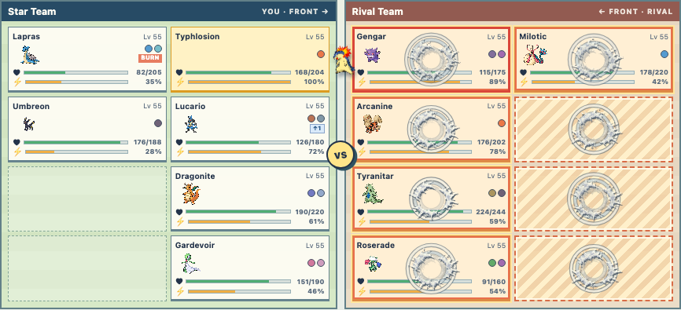
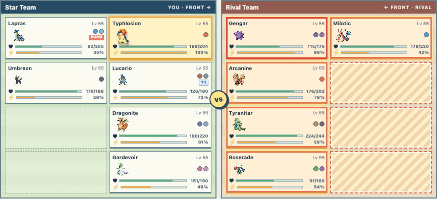
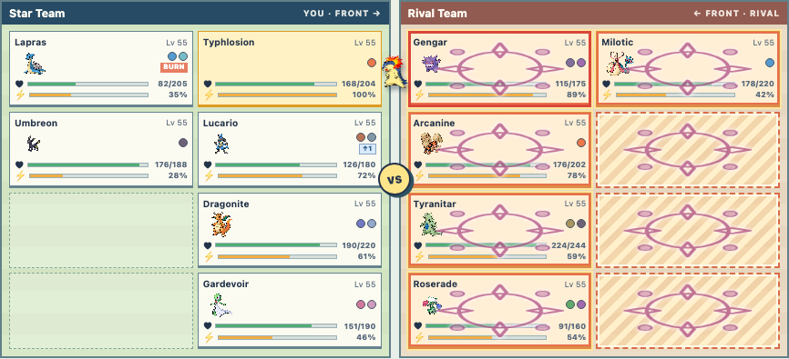
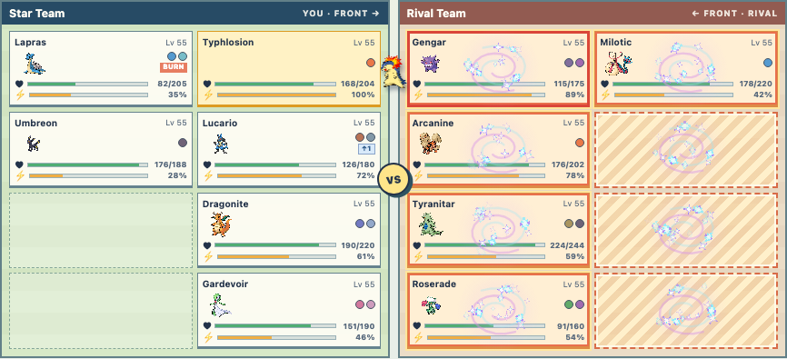
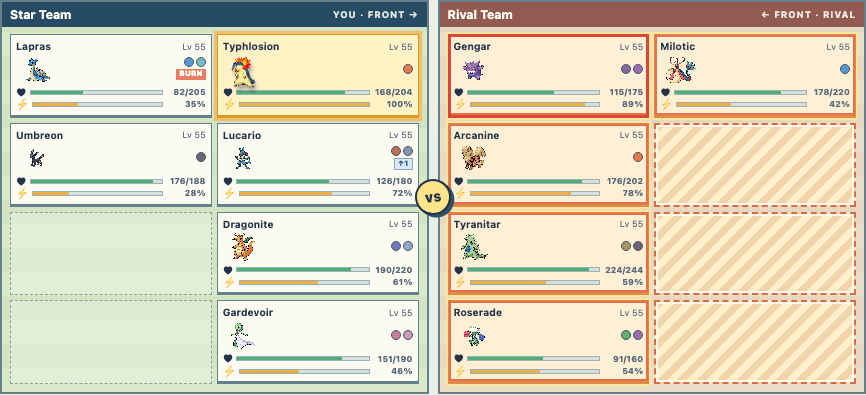

# Normal Physical and Fairy Status quality studies

Question: can small textures plus timed canvas layers make two very different
tile effects clearer and richer than the current SVG matrix?

These are throwaway development stories on the existing VFX lab. Run
`cd web && npm run dev`, then open the links below. The floating arrows or the
left/right keys compare the existing SVG with each study's alternatives.
The `pattern` control lets every variant run on one tile or a larger footprint,
including empty tiles.

| Study | Review URL | Variants |
| --- | --- | --- |
| Normal Physical | `?previewBattle=1&story=vfx&type=normal&kind=physical&pattern=all&variant=sprite` | Current SVG, pixel sprite + circles, pressure circles, impact arcs, pixel geometry, clean crescents, crossing strikes |
| Fairy Status | `?previewBattle=1&story=vfx&type=fairy&kind=status&pattern=all&variant=halo` | Current SVG, mote halo, gathering spiral, ribbon veil |

## Captures

| Normal Physical | Still at about 650 ms |
| --- | --- |
| Current SVG |  |
| Impact arcs |  |
| Pixel geometry |  |
| Clean crescents |  |
| Pixel sprite + circles |  |
| Crossing strikes |  |
| Pressure circles |  |

| Fairy Status | Still at about 650 ms |
| --- | --- |
| Current SVG |  |
| Mote halo |  |
| Gathering spiral |  |
| Ribbon veil |  |

The Normal impact variant now draws two staggered pulses, each with two or three
partial jagged arcs spanning 60–120 degrees. Radius, rotation, timing, and arc
shape vary by tile seed. The older crossing variant still uses the independently
generated streak at `media/vfx/experiments/normal-impact-streak.png`.

The three newer Normal variants isolate different approaches to removing the
hand-drawn feel. **Pixel geometry** draws three clean arcs on a 24-pixel canvas
and scales it without smoothing. **Clean crescents** uses smooth, even-width
canvas arcs and a faint inner pressure ring. **Generated pixel sprite** uses an
original transparent shock-ring image downsampled to 64 pixels; the canvas
changes its timing, size, and rotation per tile. The source prompt asked for
three disconnected, chunky ivory-gray pixel crescents with a hollow center,
few fragments, no glow, and no fine spikes; the user's impact reference was
used only for composition. The resulting project asset is
`media/vfx/experiments/normal-impact-pixel-generated.png`. The selected study
now layers three expanding pressure circles behind that sprite. The circles
alone remain available as the `ripple` variant. These alternatives share the
same two-pulse window to make visual comparison easier.

Fairy uses the existing higher-detail center mote at
`media/vfx/experiments/fairy-status-mote.png` plus two new low-resolution,
32-pixel glint and pearl sprites (`fairy-status-glint-small.png` and
`fairy-status-pearl-small.png`). Different small sprites emit outward at staggered
times through most of the VFX interval; the main mote appears occasionally as
an accent. Canvas timing, arcs, rings, ribbons, positioning, and per-tile seeded
variation are code-driven. The stories remain outside the production build.

As a choreography reference, [Pokémon Showdown's move table](https://github.com/smogon/pokemon-showdown-client/blob/master/play.pokemonshowdown.com/src/battle-animations-moves.ts)
uses two staggered expanding impact images for Giga Impact, reuses that sequence
for Double-Edge, and combines actor motion with two target-side wisps for Body
Slam. These studies use their own art and geometry.

The selected Normal study uses the sprite and circles for a short, sharp
physical pulse; circles alone remain a fallback. Fairy still tests whether a
status effect reads as magical without implying damage or a specific buff.
Production effects should use a shared actor/VFX clock. The current guidance
is in the [battle VFX creation guide](../../battle-vfx-guide.md).
