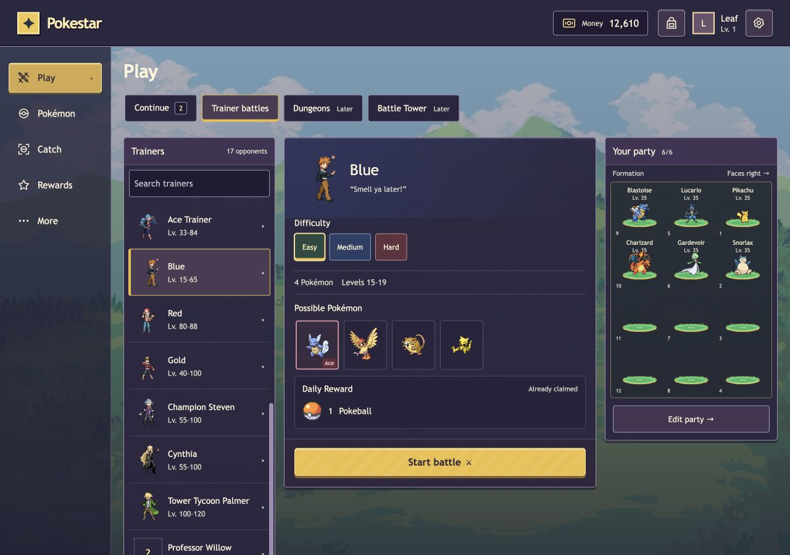
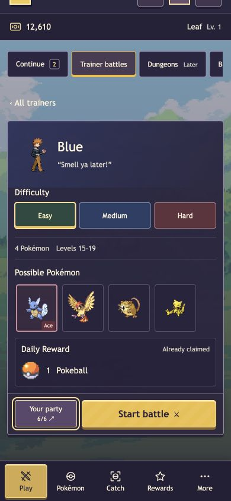
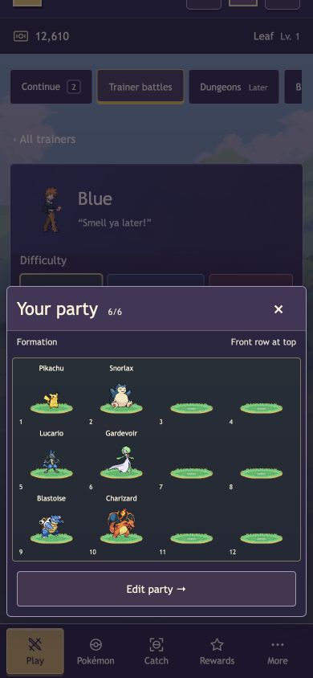

# NPC battle selection and start verification

2026-11-02, America/Los_Angeles. Implements the [approved NPC study](../design/npc-battles/README.md)
and [simplified implementation plan](../plans/2026-11-02-1847-feat-npc-battle-start-plan.md)
on `codex/web-npc-battle-implementation`, based on collection head `09f1343`.

## Implemented behavior

Play has a conditional Continue tab and the shared 17-trainer catalog. Trainer
rows show combined level ranges; encounter details show difficulty hues, an
image-only species strip with a red ace border, and daily reward icon rows.
Desktop shows the saved party beside the encounter. Tablet/phone use a native
party dialog with the existing controlled PartyView and Pokémon inspector.
Phone tabs scroll horizontally. Edit party and browser Back preserve selection.

Discord and HTTP use one NPC builder with current server-owned party validation.
HTTP starts use the existing durable battle service and normal new battle IDs.
Start is disabled during submission and released after error/timeout; another
explicit attempt is allowed. The maintainer accepts accidental duplicates.
No start reservation, identity/replay protocol, formation comparison, browser
storage requirement or extra start-recovery endpoint was added.

## Automated evidence

- Backend Jest: **946 tests / 38 suites passed**.
- Client runner: **162 tests / 30 suites passed**.
- Client TypeScript/production build passed for `/` and `/pokestar/`.
- Backend ESLint on changed files: no errors or warnings; the runner prints its
  existing React-version detection notice.
- Backend checkJs remains failing with **498 diagnostics**. Normalized file/message
  comparison against the prior collection baseline found no added or removed
  diagnostics; this is baseline preservation, not a typecheck pass.
- `git diff --check` and local Markdown references passed.

New tests first observed missing catalog/builder/API behavior, then passed after
implementation. The existing Discord durable-start characterization stayed green.
The review repair's polling regression failed when a newly discovered battle
replaced the trainer workspace, then passed after choosing the entry default once.
Coverage also includes final-active-battle disappearance, pending double activation,
retry after failure, account disposal, current party use, pure reads versus grants,
start success despite grant failure and allowlisted active summary metadata.

Build output retains existing Virtua/Rollup pure-annotation notices. Backend tests
retain the Node punycode warning and expected mocked grant-failure logging.

## Local runtime and browser evidence

A temporary loopback server served the production bundle, player API, session
store, battle services and catalog against isolated Mongo database
`pokestar_npc_qa_1793679504436`. All trainer/Pokémon/battle data was synthetic.
A local session entry replaced OAuth; no production account or database was used.

Observed:

- The catalog returned all 17 configured NPCs. Blue Easy displayed four Pokémon,
  levels 15–19, Wartortle as ace and one Pokeball as its daily reward.
- A browser start with six saved members opened its actual durable battle ID.
  The explicit interaction increased money by 10 through the existing policy.
- After stopping and restarting the Node API process with the same disposable
  database, reload continued that original battle with its original frozen setup.
- Two additional identical explicit POSTs were both accepted with distinct IDs.
  They used the current one-member saved party, and starting consumed no Dream Cards.
  The saved six-member party was restored afterward; the first battle kept six members.
- A separate Node process continued the first battle through ten player actions,
  using existing service actions. It reached completed/applied, updated the daily
  claim, and left its stored initial setup unchanged. Repeated result reads left
  money and backpack unchanged. The web then displayed Already claimed.
- Stopping the local API before a browser Start produced a connection failure.
  The UI displayed the ambiguous outcome and immediately re-enabled Start; it did
  not wait for the background refresh or send an automatic retry.
- Continue displayed the ordinary ongoing battles with NPC/difficulty labels.
  Member inspection kept six party members. Edit party → browser Back retained
  Blue/Easy. Escape dismissed the party dialog and restored the Your party trigger.
- At 1280 px the three columns measured 246/506/280 px. At 900 px the right dialog
  measured 330 px and retained three visual columns/four rows. At 390 and 320 px
  the party used four visual columns/three rows, with no horizontal document overflow.
- On the 390 px phone, Start's bar ended at 775 px and bottom navigation began at
  776 px. At 320 px, tabs overflowed a 296 px strip to 456 px; keyboard focus reached
  Battle Tower and scrolled the strip to 159.5 px.

## Review and limits

One independent read-only reviewer covered shared-service parity, authenticated
transport, account lifetime, pending/error behavior, Continue polling, route/party
reuse and native dialogs. It found one actionable defect: an initial empty-list
default could switch Trainers to Continue on polling. One repair pass latched the
entry default and added the regression above. Inert CSS fragments from the study
port were also removed. No blocking finding remains. This follows the repository's
single-review default; no full multi-model review or monitoring loop ran.

Real Discord interaction/cross-surface acceptance, Discord OAuth, physical devices
and production deployment remain unverified. Existing completion partial-write
risks remain unchanged. These checks establish local behavior, not production
readiness. No merge, push, deployment, live-account action or configuration change
was performed.
