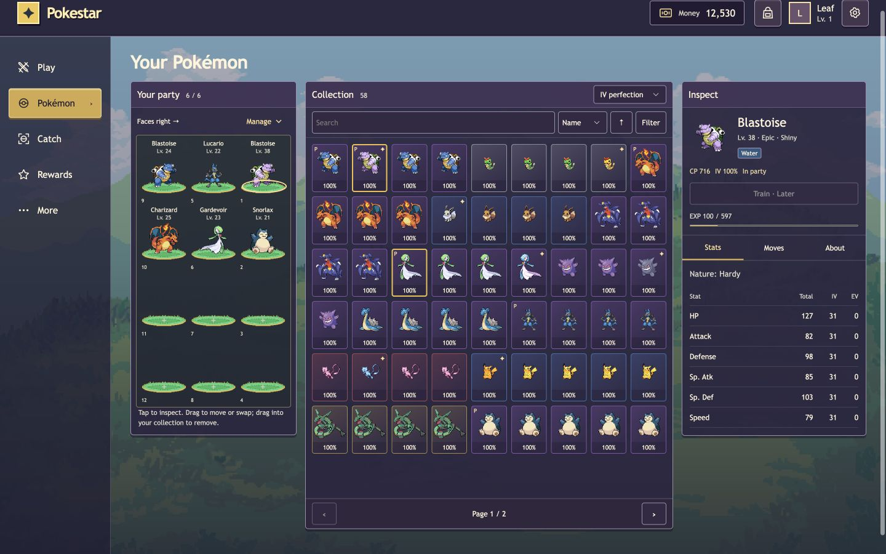
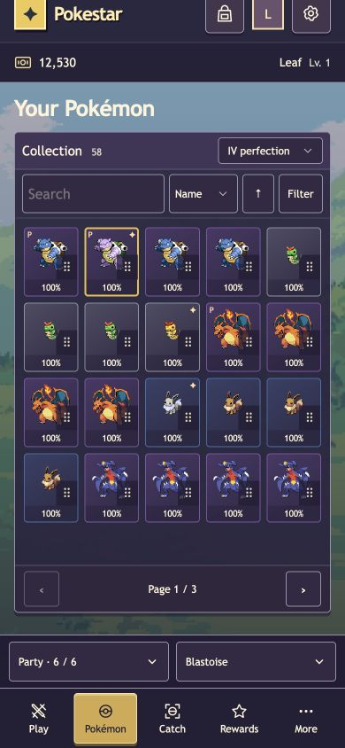
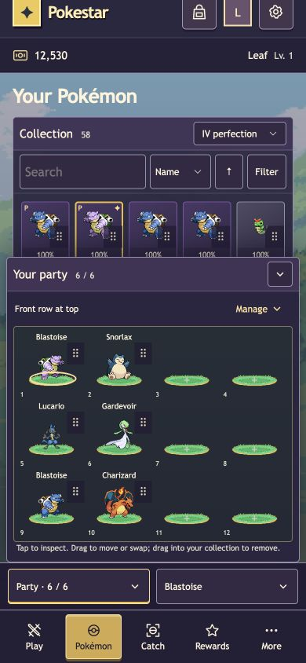

# Owned collection and party verification · 2026-11-01

Scope: approved collection workspace and lightweight shared player services,
based on design commit `7deb23d` / PR #245. See the
[approved architecture amendment](../design/owned-collection/architecture.md).

## Automated checks

- Full backend Jest suite: 938 tests / 37 suites pass.
- Client tests: 151 tests / 30 suites pass.
- Client TypeScript and production build pass with `/pokestar/` base.
- Changed backend files: ESLint has no errors, four existing JSDoc warnings.
- Backend checkJs does **not** pass: 498 existing diagnostics remain. Normalized
  file/message comparison against the trainer implementation baseline found no
  new diagnostics (line offsets excluded).

Coverage includes owner isolation, query validation and current-stat sorting,
capacity/replacement/swap/remove rules, stale target and guarded-write conflicts,
automatic reads versus participation grants, API identity/origin checks, account
cache disposal, late GET reconciliation and no ambiguous POST retries. Controlled
UI tests exercise variable geometry, tap and pointer interactions, invalid targets,
viewport resize, labels and shared move inspection.

## Runtime and browser observations

A temporary local server used the production player API, session store and services
with an isolated disposable Mongo database and 58 synthetic owned Pokémon. No
production data was used. OAuth was replaced by a local test-session entry;
battle-list behavior was a named empty fixture.

- Real Mongo owned reads returned correct totals, paging and current-CP order.
- Two concurrent removals with the same expected occupant accepted exactly one
  command; the other returned `party_changed`. Unrelated money was preserved.
- Browser inspection, full-party replacement, removal, paging, IV labels and
  Legendary filtering returned saved server state. Explicit successful actions
  updated the trainer money shown in the shared header.
- Desktop 1440×900, phone 390×844 and short phone 320×640 were checked. Short
  phone fits eight tiles with the pager above the bottom controls; the 390px
  collection has no horizontal or internal grid overflow. Party and inspection
  sheets switch without both expanding. Direct owned-selection reload opens
  inspection. Browser console contained no errors during the checked interactions.
- A mobile pager overlap found in the first pass was corrected by measuring the
  collection panel's actual viewport position and the bottom dock.

## Review and limits

An independent read-only implementation review found an uppercase ObjectId input
could occupy an invisible party slot. Commands now canonicalize candidate and
expected-occupant IDs; a regression covers outsider persistence and member swaps.
The reviewer verified the repair with a mocked service probe and found no further
blocking defects. A local cache review also added disposal checks before POST and
before installing results, with a sign-out regression.

This was a scoped independent review, not a completed full CE multi-model review:
the configured runner could not isolate staged implementation from unrelated local
HTTPS edits and concurrent working changes. Those HTTPS edits remain excluded.

Live Discord cross-surface parity, real-provider OAuth, physical touch dragging,
restart recovery and production load remain unverified. Accepted limitations:
participation rewards are best effort and may duplicate across user retries;
legacy whole-document writers and cross-document partial failures remain possible.
No transaction infrastructure, durable reward deduplication, schema migration,
training, presets or browser NPC-start flow was introduced.
